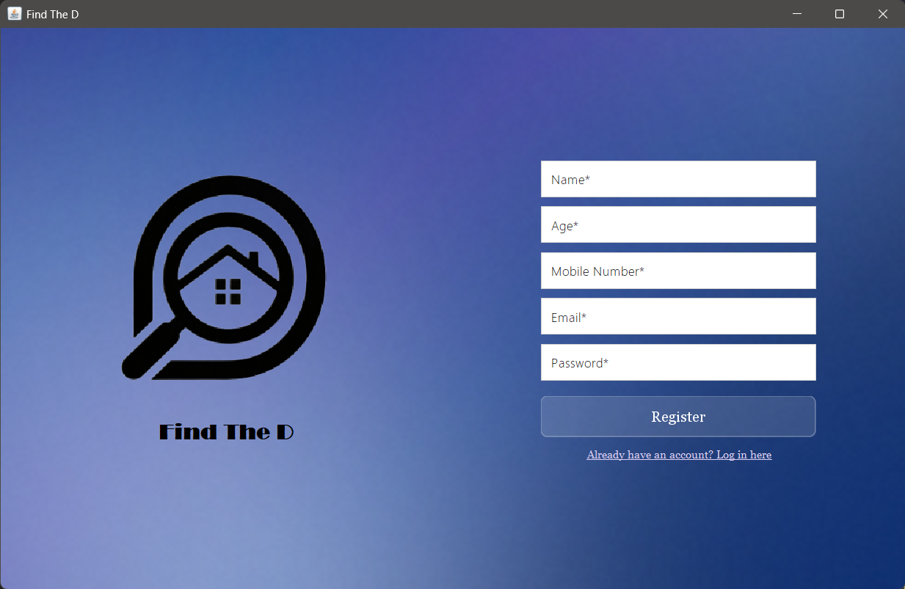
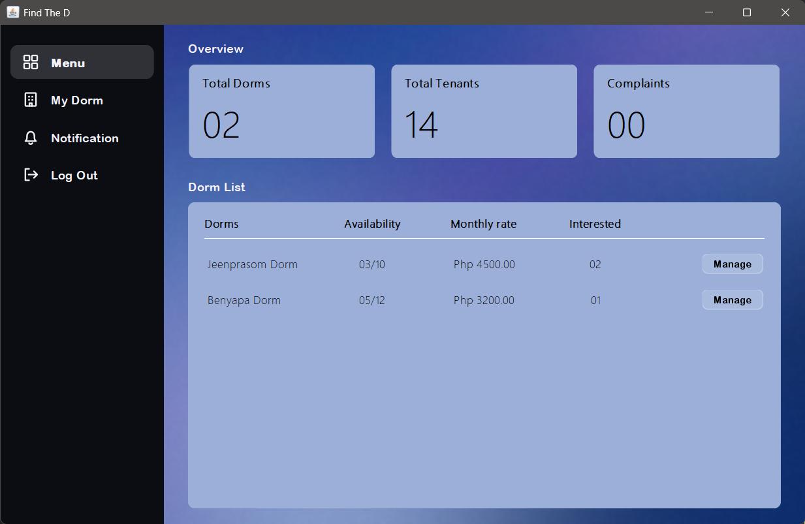
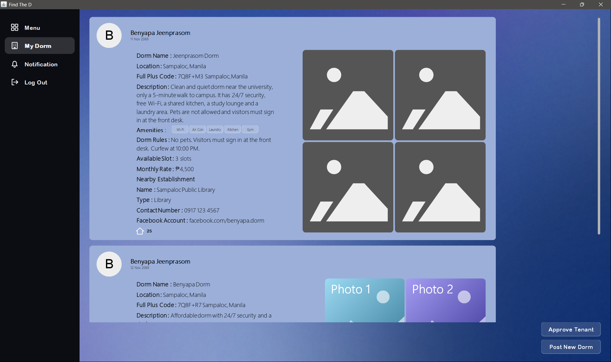
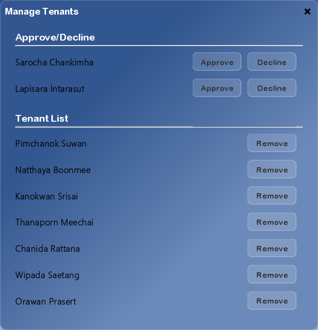
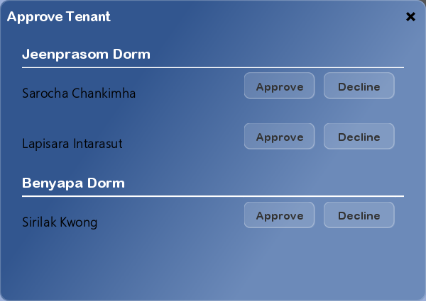
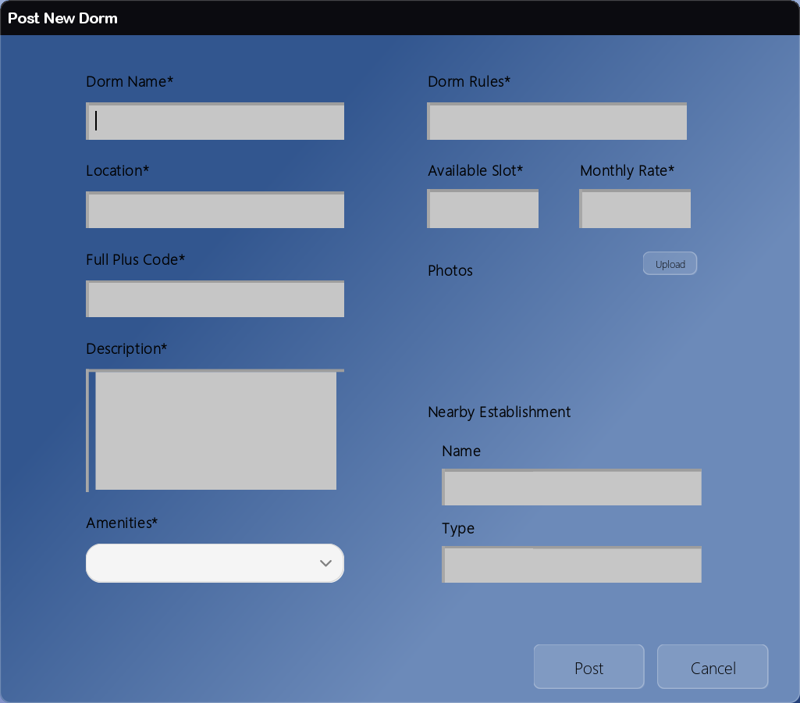
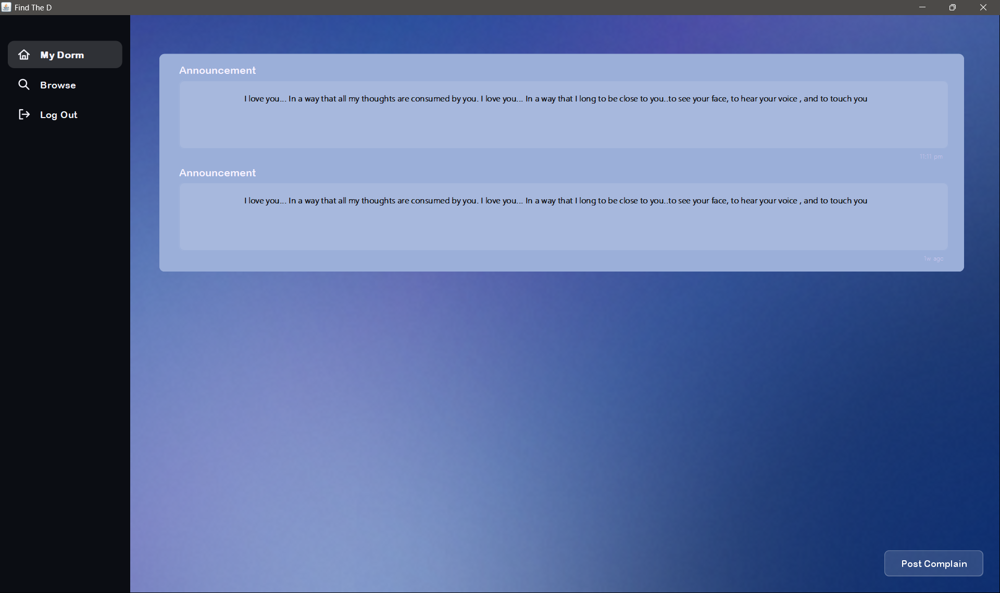
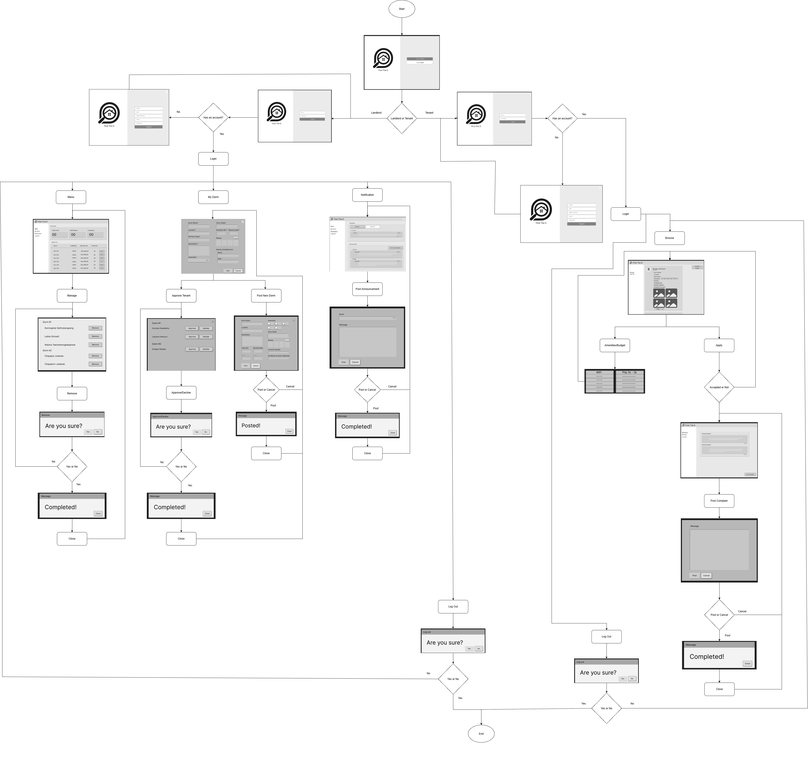

# Find The D: A Dorm Finding and Management System
A Java Swing desktop application for finding, comparing, and managing dormitories, connecting tenants looking for a place to stay with landlords who manage dorms.

## Overview
Finding a dorm is often a manual and time-consuming process. Tenants rely on Facebook groups, word of mouth, or in-person visits, and the information is scattered, incomplete, or outdated. After moving in, they may also struggle to contact their landlord or report concerns such as noise, safety, and maintenance.

Find The D puts these functions in one application. Tenants can find, compare, and apply for dorms, view their dorm details, and submit complaints. Landlords can post and manage listings, approve tenants, and send announcements. The project is built with Java Swing and applies core object-oriented programming concepts.

## Features

### Tenant Features
- Dormitory Browsing: view multiple available dorms and their listings
- Preference Filtering: filter by amenities and budget
- Dormitory Details: rental rate, amenities, rules, available slots, photos, and nearby establishments
- Interest Indicator: mark a dorm as "Interested" while notifying the landlord
- Apply to a Dorm: send an application to the landlord
- My Dorm: view announcements and dormmates for the dorm you are staying in
- Complaints: submit dorm-related concerns that only the landlord can view

### Landlord Features
- Dashboard Overview: total dorms, total tenants, and complaints at a glance
- Dormitory Listing Management: post, edit, and update dorms and room availability
- Tenant Management: approve or decline applicants and remove current tenants
- Announcements: post updates visible only to tenants of the selected dorm
- Complaint Viewing: read complaints per dorm (read-only)
- Contact Information: share contact details so tenants can reach you

### System Features
- Role-based accounts (Tenant / Landlord) with registration and login
- Input validation with clear error messages
- Persistent data storage in a file
- Interactive Swing GUI

## Screenshots

### LogIn/Register
<table>
  <tr>
    <td align="left">
       
      Role Selection
    </td>
    <td align="left">
       
      LogIn
    </td>
  </tr>
</table>

<table>
  <tr>
    <td align="left">
       
      Landlord Registration
    </td>
    <td align="left">
       
      Tenant Registration
    </td>
  </tr>
</table>

### Landlord

<table>
  <tr>
    <td align="left">
       
      Landlord Menu
    </td>
    <td align="left">
       
      Landlord Dorm Feed
    </td>
    <td align="left">
       
      Landlord Notification
    </td>
  </tr>
  <tr>
    <td align="left">
       
      Manage Tenants
    </td>
    <td align="left">
       
      Accept Tenants
    </td>
    <td align="left">
       
      Posting a Dorm
    </td>
  </tr>
    <td align="left">
       
      Posting Announcement
    </td>
</table>

### Tenant

<table>
  <tr>
    <td align="left">
       
      Tenant Browsing Feed
    </td>
    <td align="left">
       
      Dorm 
    </td>
    <td align="left">
       
      Post a Complaint 
    </td>
  </tr>
</table>

## Usage

### First Launch
- Choose I'm a Landlord or I'm a Tenant.
- Register with your name, age, mobile number, email, and password (landlords can also add a Facebook account).
- Log in with your email and password.

### As a Tenant
- Open Browse and filter dorms by amenities and budget.
- Click Apply on a dorm, or mark your interest.
- Once approved, open My Dorm to view announcements and your dormmates.
- Use Post Complaint to send a concern to your landlord.
### As a Landlord
- Use Menu to view your totals and open Manage on any dorm.
- Use My Dorm → Post New Dorm to add a listing.
- Use Approve Tenant or Manage Tenants to handle applicants and current tenants.
- Use Notification to read complaints and Post Announcement to message your tenants.

Data is saved to a file, so everything is still there the next time you open the app.

## Program Flow

    Flow

