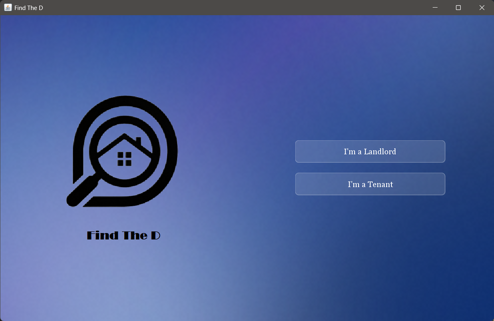
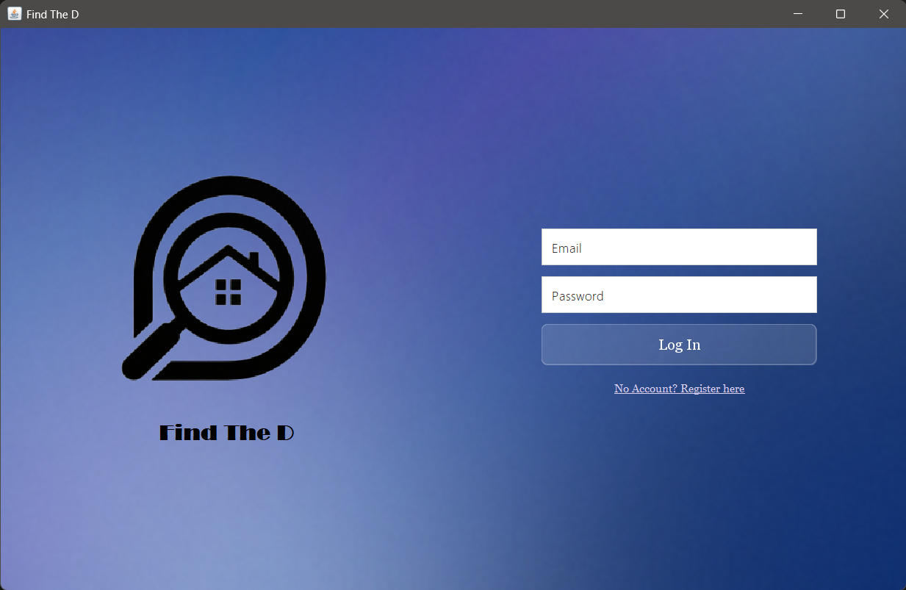
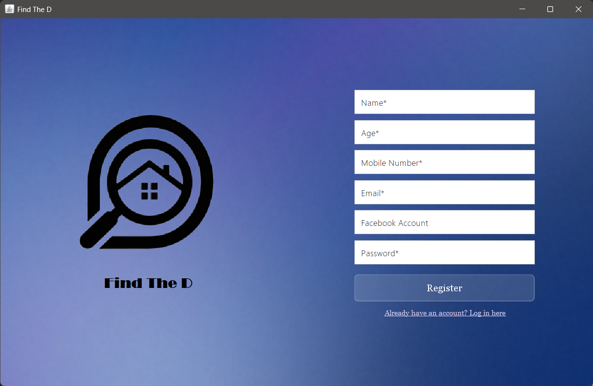
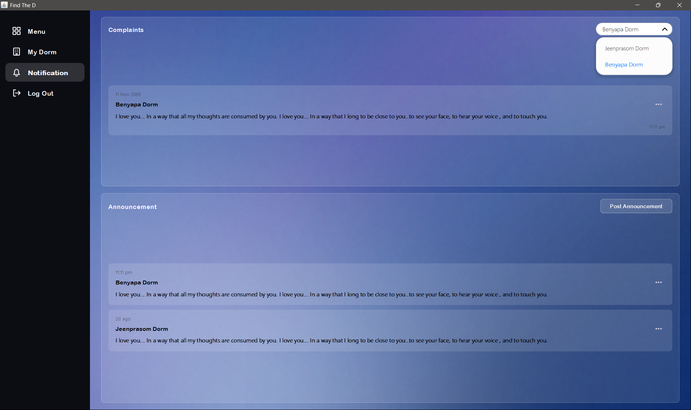
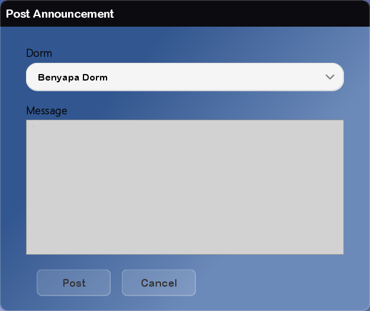
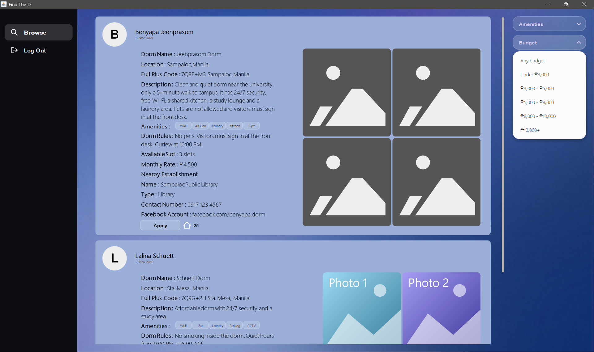
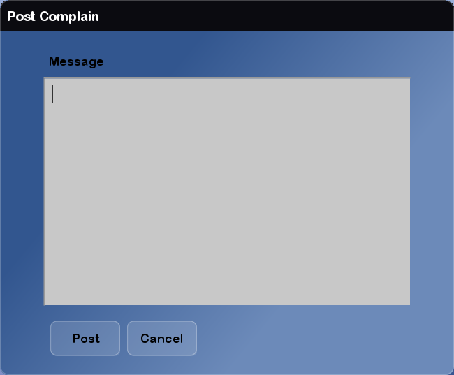

# Find The D: A Dorm Finding and Management System
A Java Swing desktop application for finding, comparing, and managing dormitories, connecting tenants looking for a place to stay with landlords who manage dorms.


## Overview
Finding a dorm is often a manual and time-consuming process. Tenants rely on Facebook groups, word of mouth, or in-person visits, and the information is scattered, incomplete, or outdated. After moving in, they may also struggle to contact their landlord or report concerns such as noise, safety, and maintenance.

Find The D puts these functions in one application. Tenants can find, compare, and apply for dorms, view their dorm details, and submit complaints. Landlords can post and manage listings, approve tenants, and send announcements. The project is built with Java Swing and applies core object-oriented programming concepts.


## Features

### Tenant Features
- Dormitory Browsing: view multiple available dorms and their listings
- Preference Filtering: filter by amenities and budget
- Dormitory Details: rental rate, amenities, rules, available slots, photos, and nearby establishments
- Interest Indicator: mark a dorm as "Interested" while notifying the landlord
- Apply to a Dorm: send an application to the landlord
- My Dorm: view announcements and dormmates for the dorm you are staying in
- Complaints: submit dorm-related concerns that only the landlord can view

### Landlord Features
- Dashboard Overview: total dorms, total tenants, and complaints at a glance
- Dormitory Listing Management: post, edit, and update dorms and room availability
- Tenant Management: approve or decline applicants and remove current tenants
- Announcements: post updates visible only to tenants of the selected dorm
- Complaint Viewing: read complaints per dorm (read-only)
- Contact Information: share contact details so tenants can reach you

### System Features
- Role-based accounts (Tenant / Landlord) with registration and login
- Input validation with clear error messages
- Persistent storage in PostgreSQL
- Interactive Swing GUI

## Screenshots

### LogIn/Register
<table>
  <tr>
    <td align="center">
      <br>
      Role Selection
    </td>
    <td align="center">
      <br>
      LogIn
    </td>
  </tr>
</table>


<table>
  <tr>
    <td align="center">
      <br>
      Landlord Registration
    </td>
    <td align="center">
      <br>
      Tenant Registration
    </td>
  </tr>
</table>


### Landlord

<table>
  <tr>
    <td align="center">
      <br>
      Landlord Menu
    </td>
    <td align="center">
      <br>
      Landlord Dorm Feed
    </td>
    <td align="center">
      <br>
      Landlord Notification
    </td>
  </tr>
  <tr>
    <td align="center">
      <br>
      Manage Tenants
    </td>
    <td align="center">
      <br>
      Accept Tenants
    </td>
    <td align="center">
      <br>
      Posting a Dorm
    </td>
  </tr>
    <td align="center">
      <br>
      Posting Announcement
    </td>
</table>

### Tenant

<table>
  <tr>
    <td align="center">
      <br>
      Tenant Browsing Feed
    </td>
    <td align="center">
      <br>
      Dorm 
    </td>
    <td align="center">
      <br>
      Post a Complaint 
    </td>
  </tr>
</table>


## Usage

### First Launch
- Choose I'm a Landlord or I'm a Tenant.
- Register with your name, age, mobile number, email, and password (landlords can also add a Facebook account).
- Log in with your email and password.

### As a Tenant
- Open Browse and filter dorms by amenities and budget.
- Click Apply on a dorm, or mark your interest.
- Once approved, open My Dorm to view announcements and your dormmates.
- Use Post Complaint to send a concern to your landlord.
### As a Landlord
- Use Menu to view your totals and open Manage on any dorm.
- Use My Dorm → Post New Dorm to add a listing.
- Use Approve Tenant or Manage Tenants to handle applicants and current tenants.
- Use Notification to read complaints and Post Announcement to message your tenants.

Accounts, listings, applications, interests, announcements, and complaints are stored in PostgreSQL and remain available after the app closes.

## UI Source Layout

The Swing interface is organized into Java packages under `src/ui`:

- `ui.FindTheDUI` is the application entry point.
- `ui.screens` contains welcome, login, and registration screens.
- `ui.tenant` and `ui.landlord` contain the role-specific dashboards.
- `ui.components` contains shared Swing widgets, buttons, dialogs, and photo controls.
- `model`, `service`, `repository`, `enums`, `exception`, and `util` contain the shared backend domain, database, and business logic used by the UI.
- `logo.png` is the UI logo resource.

Run the application with `Main` as the main class.


## Program Flow

<p align="center">
  <br> Flow
</p>


## Java and OOP Concepts

| Concept | How It Is Used |
| :--- | :--- |
| *Classes and Objects* | Tenants, landlords, dorms, rooms, complaints, and announcements are each a class. Each new dorm or complaint is a new object. |
| *Methods* | Each class has its own actions, e.g. applyToDorm(), postDorm(), makeAnnouncement(), updateDetails(). |
| *Encapsulation* | Passwords and the identity of a tenant who files an anonymous complaint are private and only reachable through controlled methods. |
| *Inheritance* | Tenant and Landlord inherit shared attributes and actions from Person. |
| *Polymorphism* | Both roles have a dashboard, but each shows different content depending on the user type. |
| *Abstraction* | Users apply, view, or post without needing to know how data is stored and updated in the background. |
| *Exception Handling* | Clear messages for empty fields, wrong login details, duplicate emails, or applying to a dorm with no slots. |
| *Data Handling* | PostgreSQL stores accounts, listings, applications, interests, announcements, and complaints. |


## Class Overview

<details>
<summary><b> Class Overview</b> (click to expand)</summary>

<br>

| Class | Purpose | Main Attributes | Main Methods |
| :--- | :--- | :--- | :--- |
| `Person` | Parent of `Tenant` and `Landlord` | `name`, `age`, `contactNum` | `displayInfo()` |
| `Tenant` | A tenant looking for or staying in a dorm | `program`, `currentDorm` | `viewMyDorm()`, `complain()`, `lookForDorm()`, `applyToDorm()` |
| `Landlord` | The dorm owner | `handledDorms[]` | `postDorm()`, `manageDorm()`, `makeAnnouncement()`, `viewComplaints()` |
| `Dorm` | A dorm posted by a landlord | `dormName`, `location`, `owner`, `tenants[]`, `availableSlots` | `addTenant()`, `removeTenant()`, `updateDetails()`, `displayInfo()` |

```
Person
├── Tenant
└── Landlord ── manages ──▶ Dorm ── houses ──▶ Tenant
```

</details>


## Limitations
- No payment or transaction feature for paying rent through the app.
- Transactions between tenants and landlords to secure a dorm are not supported.
- Landlords can view complaints but cannot respond to them through the system.


## Future Enhancements
- In-app payment of rent
- Landlord replies to complaints

##  Development Schedule

<details>
<summary><b>8-week roadmap</b> (click to expand)</summary>

<br>

| Week | Activity | Expected Output |
| :--- | :--- | :--- |
| 1 | Planning and requirements | Project Proposal |
| 2 | System and class design | Class/UML Diagram |
| 3 | Initial coding | Basic classes |
| 4-5 | Feature development | Working features |
| 6 | OOP implementation | Completed OOP features |
| 7 | Testing and debugging | Tested system |
| 8 | Documentation and presentation | Final project |

</details>

## Team

College of Informatics and Computing Sciences

| Member | Assigned Tasks |
| :--- | :--- |
| Cusi, Princess Arrianne M. | README, testing documentation, screenshots |
| Dalisay, Rizialyn A. | Requirements, class design, UML diagrams |
| Driz, Neil Mathew L. | Java classes, methods, OOP features |
| Oatis, Dylan Luke P. | Tasks, deadlines, communication with instructor |

<div align="center">

## Thank You!

Thanks for checking out **Find The D**.
We hope it makes finding and managing a dorm a little easier.

*Built with Java, Swing, and a lot of teamwork.* 

**Feedback and suggestions are always welcome!**

</div>


