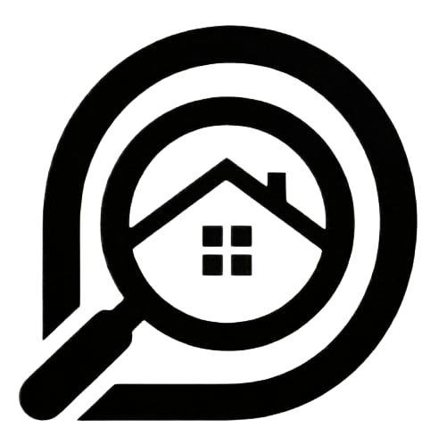

<div align = "center">

---
<br>

# **Find The D** 
### A Dorm Finding and Management System
A Java Swing desktop application for finding, comparing, and managing dormitories, connecting **tenants** looking for a place to stay with **landlords** who manage dorms.

</div>

---
<div align = "center">

**[🏠 Overview](#overview)&nbsp;&nbsp;&nbsp;&nbsp;· [🏠 Features](#features)&nbsp;&nbsp;&nbsp;&nbsp;· [🏠 OOP](#java-and-oop-concepts)&nbsp;&nbsp;&nbsp;&nbsp;· [🏠 Structure](#project-structure)&nbsp;&nbsp;&nbsp;&nbsp;· [🏠 Run](#how-to-run)&nbsp;&nbsp;&nbsp;&nbsp;· [🏠 Screenshots](#️screenshot️) · [🏠 Team](#meet-the-team)&nbsp;&nbsp;&nbsp;&nbsp;**

</div>

---

# Overview

> **"Is this room still available?"**   *"Seen."*  

Sound familiar? Finding a dorm usually means digging through Facebook groups, asking around, and visiting places in person. The info is scattered, incomplete, or already outdated. And once you move in, reaching your landlord or reporting a noise, safety, or maintenance concern isn't any easier.

Find The D puts these functions in one application. Tenants can find, compare, and apply for dorms, view their dorm details, and submit complaints. Landlords can post and manage listings, approve tenants, and send announcements. The project is built with Java Swing and applies core object-oriented programming concepts.

---

## Features

<div align = "center">

<table>
<tr>
<td width="50%" valign="top">

<h3 align = "center"> 🙍 The Tenant </h3>

*On a quest for the perfect room.*

-  Browse & filter dorm listings
-  Check rates, amenities, rules & photos
-  See the map and nearby establishments
-  Mark dorms as **Interested**
-  **Finalize** the one you love
-  Meet your dormmates & landlord
-  Read your dorm's announcements
-  Send complaints, even anonymously

</td>
<td width="50%" valign="top">

<h3 align = "center"> 🏠 The Landlord </h3>

*Keeping the house full and happy.*

-  Post a new dorm listing
-  Edit details & available slots
-  Remove a dorm (with a confirmation!)
-  Announce news to your tenants
-  Read tenant complaints (read-only)
-  See a dashboard of all your dorms
-  Get notified when students show interest

</td>
</tr>
</table>

</div>

---

##  What It Can Do

|| Feature | The Magic Behind It |
| :---: | --- | --- |
|| **Smart Registration** | Validates name, email, password strength, age (16–120), and Philippine mobile numbers before you get in. |
|| **Dorm Discovery** | A filter bar that helps you skip the noise and find the right fit faster. |
|| **Rich Dorm Pages** | Rate, amenities, house rules, photos, open slots, landlord contact, plus a map with nearby establishments. |
|| **Slot Tracking** | Finalizing a dorm updates availability automatically. When slots hit zero, the app says no (politely). |
|| **Plus Code Locations** | Uses full Open Location Codes and decodes them into map coordinates. |
|| **Targeted Announcements** | Up to 1000 characters, delivered only to tenants of that dorm. |
|| **Anonymous Complaints** | Tick the box and the sender is never stored. Not hidden, *never stored*. |
|| **Rock-solid Validation** | Custom exceptions catch bad input before it can cause trouble. |

---

## Java and OOP concepts

<details>
<summary><b> Core Java Concepts</b></summary>

<br>

| Concept | How It Is Used |
| :--- | :--- |
| *Classes and Objects* | Tenants, landlords, dorms, rooms, complaints, and announcements are each a class. Each new dorm or complaint is a new object. |
| *Methods* | Each class has its own actions, e.g. `applyToDorm()`, `postDorm()`, `makeAnnouncement()`, `updateDetails()`. |
| *Exception Handling* | Clear messages for empty fields, wrong login details, duplicate emails, or applying to a dorm with no slots. |
| *Data Handling* | PostgreSQL stores accounts, listings, applications, interests, announcements, and complaints. |

</details>

<details>
<summary><b> Encapsulation</b></summary>

<br>

Passwords and the identity of a tenant who files an anonymous complaint are **private** and only reachable through controlled methods.

```java
public class Complaint {
    private String message;
    private Tenant sender;      // null when anonymous
    private boolean anonymous;

    public String getMessage() { return message; }
}
```

</details>

<details>
<summary><b> Inheritance</b></summary>

<br>

`Tenant` and `Landlord` inherit shared attributes and actions from `Person`.

```java
public class Tenant extends Person {
    private String program;
    private Dorm currentDorm;
}

public class Landlord extends Person {
    private List<Dorm> handledDorms;
}
```

</details>

<details>
<summary><b> Polymorphism</b></summary>

<br>

Both roles have a dashboard, but each shows different content depending on the user type.

```java
Person user = authService.login(email, password);
user.showDashboard();   // Tenant or Landlord version runs at runtime
```

</details>

<details>
<summary><b> Abstraction</b></summary>

<br>

Users apply, view, or post without needing to know how data is stored and updated in the background.

```java
// The caller only says what to do, not how it is saved.
tenant.applyToDorm(dorm);
landlord.postDorm(newDorm);
```

</details>


## UI Source Layout

The Swing interface is organized into Java packages under `src/ui`:

- `ui.FindTheDUI` is the application entry point.
- `ui.screens` contains welcome, login, and registration screens.
- `ui.tenant` and `ui.landlord` contain the role-specific dashboards.
- `ui.components` contains shared Swing widgets, buttons, dialogs, and photo controls.
- `model`, `service`, `repository`, `enums`, `exception`, and `util` contain the shared backend domain, database, and business logic used by the UI.
- `logo.png` is the UI logo resource.

Run the application with `Main` as the main class.


## ‼️Project Structure‼️

```
Find-The-D/
├──  data/              # Sample & seed data
├──  database/          # Database files & schema
├──  docs/              # Design docs, class design, service API
│   ├──  sketches/      # Wireframes of every screen
│   └──  screenshots/   # App screenshots
├──  src/               # The app itself
│   ├── model/          # Person, Tenant, Landlord, Dorm, Announcement,
│   │                   # Complaint, Establishment
│   ├── service/        # Auth, Dorm, Interest, TenantHome,
│   │                   # Complaint, Announcement services
│   ├── util/           # Validator, PlusCode
│   ├── exception/      # Custom exceptions
│   └── view/           # Tenant & Landlord screens
└──  README.md          # You are here!
```

---

### ‼️ UML Class Diagram‼️
```
```
---
## How To Run

### Requirements
-  **JDK 17+** installed and on your `PATH`
-  **PostgreSQL** installed locally, with `psql` available in your terminal
-  A free **[Geoapify](https://myprojects.geoapify.com/)** API key (needed to post a dorm with a Plus Code)
-  An IDE like **IntelliJ IDEA**, **VS Code**, or **Eclipse**

### Setup
First, **Clone the repo**
```bash
git clone https://github.com/ivOfFade/Find-The-D.git
cd Find-The-D
```

Second, **Create the database**
```bash
psql -U postgres -c "CREATE DATABASE findtheddb;"
```

Third is, **Create the tables** *(run from the repository root)*
```bash
psql -U postgres -d findtheddb -v ON_ERROR_STOP=1 -1 -f database/schema.sql
```

Fourth, **Seed the sample data** *(run this once only)*
```bash
psql -U postgres -d findtheddb -v ON_ERROR_STOP=1 -f database/seed.sql
```

Next is, **Verify the tables**
```bash
psql -U postgres -d findtheddb -c "\dt"
```
You should see tables for dorms, amenities, photos, applications, complaints, announcements, and nearby establishments.

And then, **Add your `.env` file** in the repository root:
```text
DB_URL=jdbc:postgresql://localhost:5432/findtheddb
DB_USER=your_postgres_username
DB_PASSWORD=your_postgres_password
GEOAPIFY_API_KEY=your_geoapify_api_key
```
>  Keep `.env` local and never commit it. Make sure it's listed in `.gitignore`.

And now, **Start the system** *(replace with your actual run command / entry class)*
```bash
javac -d out $(find src -name "*.java")
java -cp out Main
```


**Pick your Role**

| 🙍 Tenant Path | 🏠 Landlord Path |
| --- | --- |
| Login → Browse → Interested → Apply → Check *My Dorm* → Read announcements → Send a complaint | Login → Post a dorm → Edit slots → Publish an announcement → Read complaints |

<details>
<summary><b> Already have an older database? (Migration)</b></summary>

<br>

If your database was created before nearby OpenStreetMap results were stored, run this once:

```bash
psql -U postgres -d findtheddb -v ON_ERROR_STOP=1 -1 -f database/migrations/001_dorm_nearby_establishments.sql
```

</details>

<details>
<summary><b> Want to start over? (Reset)</b></summary>

<br>

```bash
psql -U postgres -c "DROP DATABASE findtheddb;"
psql -U postgres -c "CREATE DATABASE findtheddb;"
psql -U postgres -d findtheddb -v ON_ERROR_STOP=1 -1 -f database/schema.sql
psql -U postgres -d findtheddb -v ON_ERROR_STOP=1 -f database/seed.sql
```

</details>

<details>
<summary><b> How nearby places work (Geoapify)</b></summary>

<br>

When a landlord posts a dorm with a Plus Code, the app asks Geoapify's Places API (built on OpenStreetMap data) for nearby places before saving the listing. It then stores each place and its straight-line distance in `dorm_nearby_establishments`.

- A Geoapify API key is **required** to post a dorm with a Plus Code.
- If the lookup fails, the listing is **not saved**, and the landlord can retry later.
- Existing listings are **not backfilled**.
- The free plan currently allows up to 3,000 requests per day, so check Geoapify's current limits and terms.
- The results screen includes Geoapify and OpenStreetMap attribution links.

</details>

### 📌 Good to Know

-  Never commit your Postgres credentials or API key.
-  The seed file is for a **fresh** database. It does not clear or overwrite existing data.
-  The full schema is in `database/schema.sql`.
-  Announcements only reach the tenants of the posting dorm.
-  Anonymous complaints never reveal who sent them.
---
# ‼️screenshot‼️
```
```
---

The core OOP examples are encapsulation through private model fields and validated accessors, inheritance through `Tenant` and `Landlord` extending `Person`, polymorphism through overridden methods such as `displayInfo()`, and abstraction through the abstract `Person` class and repository interfaces.


## Limitations 
1. **Local data only:** Data lives in the project database and doesn't sync across devices.
2. **No in-app payments:** Rent and reservation fees are settled directly between tenant and landlord.
3. **No live chat:** Communication happens through announcements and landlord contact details.

##  Future Improvements 

- [ ]  Direct messaging between tenants and landlords
- [ ]  Dorm ratings and reviews
- [ ]  Live map search with distance-to-campus sorting
- [ ]  Email / SMS notifications for announcements and new slots

---

##  Meet the Team

<div align="center">

<table>
<tr>
<td align="center" width="25%">
<a href="https://github.com/OasisTree">
<br>
<b>Dylan</b>
</a><br>
Backend Core & Shared Models<br><br>
</td>

<td align="center" width="25%">
<a href="https://github.com/nylspace">
<br>
<b>Neil</b>
</a><br>
Backend Landlord & Code Review<br><br>
</td>

<td align="center" width="25%">
<a href="https://github.com/rd-ev">
<br>
<b>Shasha</b>
</a><br>
Tenant Frontend & Sketches<br><br>
</td>

<td align="center" width="25%">
<a href="https://github.com/khunarrianne">
<br>
<b>Arrianne</b>
</a><br>
Landlord Frontend & Sketches<br><br>
</td>
</tr>
</table>

</div>

---

## *Acknowledgement*

&nbsp;&nbsp;&nbsp;&nbsp;&nbsp;&nbsp;A big, heartfelt **thank you** to our Object-Oriented Programming professor, **Ms. Fatima Marie P. Agdon**, for the guidance, patience, and feedback that shaped every class in this project. 

&nbsp;&nbsp;&nbsp;&nbsp;&nbsp;&nbsp;Thanks also to our families, friends, and everyone who tested, tweaked, and cheered us on, and to the late-night coffee that powered our commits. 

---

<div align="center">

##  **Thank You for Reading!**

**Find The D** is our way of saying that finding a home shouldn't feel like a quest.
If it makes even one student's search easier, it did its job. 

⭐ *If you like the project, give it a star. It makes our day!* ⭐

See the [UML class diagram](docs/uml/UML%20Diagram.pdf) and the more detailed [class design](docs/class-design/class-design.md) for the relationships and responsibilities of the project classes.


**DISCLAIMER**
This project is created for educational purposes under the Object-Oriented Programming course.<br>
© 2026 Team *Find The D*. All rights reserved.

</div>


