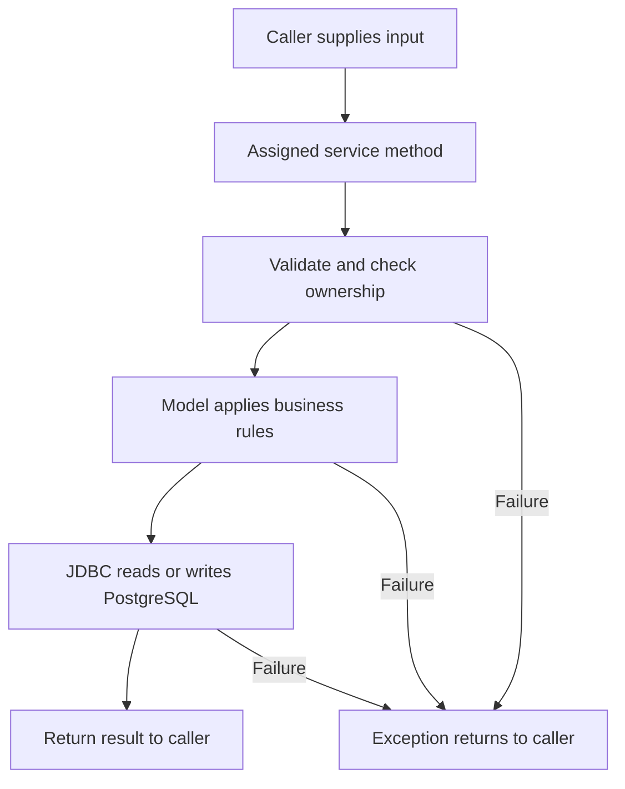
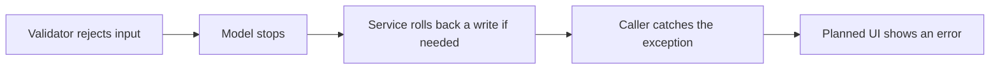
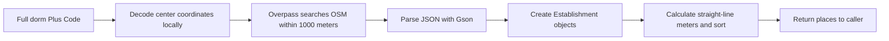
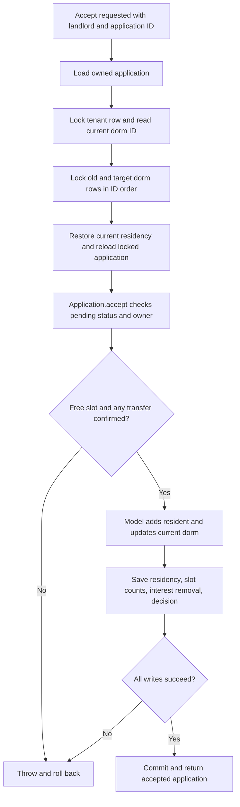

# Dylan's assigned code: start here

For a file-by-file reading sequence, start with
[04-file-study-order.md](04-file-study-order.md). Use this file for the detailed
code explanations, then read [the entire backend flow](02-entire-backend-flow.md)
and [the frontend and backend together](03-entire-system-with-frontend.md).
These guides explain the project. They do not change its Java code.

The flowcharts use Mermaid. Open these documents in a Markdown preview that
supports Mermaid to see the diagrams; their steps are also explained in text.

This guide covers your original core landlord/dorm assignment [05], your
landlord service assignments [10], [11], and [12], and the OpenStreetMap feature
you separately requested. Neil's tenant classes are explained where your code
calls them; their full role is covered in the second guide.

**How to read the examples:** names, IDs, amounts, dates, and outputs are
illustrations of the intended execution. They are not results from a running
database. The project currently has compilation blockers, several student
services are absent or empty, and the UI is not connected. Written logic and
an end-to-end working application are different states.

## 1. What a Java file represents

A class describes data and the operations that use it. An object is one
instance of that class in the running program.

```java
Landlord maria = new Landlord(
    "Maria Santos", 35, "09171234567", "maria@example.com", "ExamplePass123"
);
```

Here, `Landlord` is the type, `maria` is the variable referring to the object,
and `new Landlord(...)` calls a constructor. The password above is fictional.

| Java term | Meaning in this project |
|---|---|
| Field/attribute | Data stored in an object, such as `Dorm.totalSlots` |
| Constructor | Initializes a newly created object |
| Method | Performs an operation, such as `dorm.hasTenants()` |
| Parameter | A named input received by a method |
| Argument | The actual value supplied in a call |
| Return value | The result given back to the caller |
| `this.name` | The current object's field named `name` |
| `null` | No object reference; a tenant with no dorm has `currentDorm == null` |
| `void` | The method returns no result value |
| `boolean` | Either `true` or `false` |
| `int` | A whole number; a primitive `int` cannot contain null |
| `List<Dorm>` | A collection whose elements are Dorm objects |
| `Map<String, Integer>` | Values retrieved by text keys, such as `totals.get("availableSlots")` |

### Access modifiers and other words

- `public`: other classes can call it.
- `private`: used only inside that class.
- No access modifier: accessible within the same package. For example,
  `ListingService.requireLandlord` can be called by other classes in `service`.
- `static`: belongs to the class. Call `Validator.name(value)` without creating
  a Validator object.
- `final` class: cannot be subclassed. `Validator` is a utility class.
- `final` field: cannot be reassigned after initialization. A final list
  reference can still have elements added unless the list itself is read-only.
- `abstract` class: cannot be directly instantiated. You create a Landlord or
  Tenant, rather than `new Person(...)`.
- `abstract` method: declares an operation whose implementation is supplied by
  a concrete subclass, such as `getDashboardType()`.
- `@Override`: tells Java that this method replaces an inherited method. It
  does not cause the method to run automatically.

`package model;` identifies a class's package. `import model.Dorm;` lets another
file refer to that class by its short name. After the requested source move,
package folders are directly inside `src/main`.

## 2. What your different kinds of classes do

| Kind | Project examples | Responsibility |
|---|---|---|
| Enum | Role, ApplicationStatus | Limits a value to named choices |
| Model | Landlord, Dorm, Announcement | Holds domain data and enforces its rules |
| Utility | Validator, PasswordHasher | Shared small operations |
| Exception | InvalidInputException | Identifies a failed operation |
| Service | ListingService, AnnouncementService | Completes a requested operation |
| Repository | PersonRepository, DormRepository | Contains existing database persistence operations |

The **current landlord services contain their own JDBC SQL** after the extra
landlord repository was removed. Some other existing backend code still uses
repository classes. Do not describe every service call as going through a
separate repository file: that would not match the current source.



The frontend call sites in this chart are intended wiring. The current screen
files are still empty.

## 3. Issue [05]: the four enums

Open [src/main/enums](../src/main/enums).

| File | Current choices | Used for |
|---|---|---|
| [Role.java](../src/main/enums/Role.java) | TENANT, LANDLORD | Type of account |
| [DashboardType.java](../src/main/enums/DashboardType.java) | TENANT_LISTINGS, TENANT_DORM_HOME, LANDLORD_DASHBOARD | Which screen area should open |
| [ApplicationStatus.java](../src/main/enums/ApplicationStatus.java) | PENDING, ACCEPTED, REJECTED | Owner's decision on an application |
| [EstablishmentType.java](../src/main/enums/EstablishmentType.java) | STORE, LAUNDRY, GROCERY, SCHOOL, PHARMACY, OTHER | Category of a nearby establishment |

An account's role and dashboard are related but different. Ana remains a
TENANT both before and after acceptance. Her dashboard changes from listings
to dorm home when she obtains a current dorm. Maria remains a LANDLORD.

`status == ApplicationStatus.PENDING` compares an enum choice. When SQL needs
the stored text, `status.name()` produces `"PENDING"`.

## 4. Issue [05]: exceptions and how a failure travels

The six files in [src/main/exception](../src/main/exception) are separate types
of failure. Their constructors pass a message to Java's parent Exception class.
The distinct types let a caller respond differently without inspecting the
wording of a message.

| Exception | Meaning | Example context |
|---|---|---|
| AuthenticationException | Login credentials were rejected | Person.login rejects a password |
| EmailAlreadyRegisteredException | Email is already registered | Required registration-service behavior; AuthService is currently empty |
| InvalidInputException | Input or requested action violates a rule | Blank message or capacity below occupancy |
| DormNotFoundException | Tenant has no current dorm | Tenant.viewMyDorm |
| NoAvailableSlotsException | Target dorm is full | Application acceptance |
| UnauthorizedActionException | Actor cannot perform the operation | Another owner's dorm was requested |

`SQLException` is supplied by Java's SQL library. It is used for database
read/write failures; it is not one of your custom exception files.

```java
public final void setName(String name) throws InvalidInputException {
    this.name = Validator.name(name);
}
```

Read this as: receive a candidate name, ask the validator to check it, and
assign the returned value if validation succeeds. If validation throws an
exception, the assignment is not completed.

- `throw new InvalidInputException(...)` actually raises the exception.
- `throws InvalidInputException` declares that the method may let it escape.
- A caller either catches the checked exception or declares it in its own
  `throws` list.
- A UI normally catches it to show a message. That UI handling is still planned.



Inside a service transaction, `catch` is used to roll back and then rethrow.
That does not mean the error was solved; it ensures a failed write is not
presented as a successful operation.

## 5. Issue [05]: Validator.java

Open [Validator.java](../src/main/util/Validator.java).

This utility checks inputs and often returns a cleaned value. Its private,
empty constructor prevents creating Validator instances; there is no code you
need to put inside that constructor.

| Method/group | What the current code does |
|---|---|
| `required(String, fieldName)` | Rejects null/blank text and returns trimmed text |
| `required(Role, fieldName)` | Rejects a missing Role |
| `requiredReference` | Rejects a null object; returns the same reference |
| `name` | Requires text, at most 100 characters |
| `age` | Rejects values below 18; there is currently no upper bound in this method |
| `contactNum` | Accepts 09 followed by nine digits, or +639 followed by nine digits |
| `email` | Requires a format matching its regular expression; preserves letter case |
| `password` | Requires nonblank input, at least eight characters, at most 72 UTF-8 bytes; returns the original password |
| `role` | Checks that a Role exists |
| `plusCode` | Constructs a validated PlusCode |
| `optionalPlusCode` | Returns null for missing/blank input, otherwise validates it |
| `message` | Requires trimmed text of at most 1000 characters |
| `otherContact` | Rejects length above 100; its current error text incorrectly says 1000 |
| `dormName` | Requires text of at most 150 characters |
| `location` | Allows null; trims supplied text and limits length to 255 |
| `totalSlots` | Requires at least one |
| `rate` | Requires a finite number greater than zero |
| `amenities` / `photos` | Call copyEntries to validate entries and create a new list |
| `copyEntries` | Rejects null lists, trims entries, enforces lengths, removes exact duplicates |
| `capacity` | Rejects negative occupancy or total slots below the occupants |
| `savedId` | Requires a positive ID |
| `establishmentName` | Requires a name, with a current maximum of 150 |
| `condition` | Throws the supplied message when a boolean condition is false |

`<T>` in `requiredReference` means the helper can accept different reference
types and return the same type. It can check a Dorm or Landlord without a
separate method for each one.

**Requirement versus current code:** your issue and SQL schema specify ages
16–120, but this Java method currently accepts 18 and above. The issue requires
lowercase stored emails, while this method does not lowercase them. These are
existing differences to understand, not fixes made by these learning files.

If the UI age field is empty, the UI first has text, not an int. The planned
form handler needs to check/parse that text before calling an int-based model
constructor. An int cannot be compared to null.

## 6. PasswordHasher and the two password situations

Open [PasswordHasher.java](../src/main/util/PasswordHasher.java).

```java
return BCrypt.hashpw(rawPassword, BCrypt.gensalt(12));
```

`gensalt(12)` creates bcrypt's random salt and cost setting. `hashpw` combines
them with the supplied password and returns a stored bcrypt string. That
string contains the information needed to verify a later password, including
the salt and cost; no separate salt column is required by this implementation.

```java
return BCrypt.checkpw(rawPassword, storedHash);
```

At login, checkpw reads the saved bcrypt information and checks the candidate
password against it. The code does not make an unrelated fresh salted hash and
compare the two strings. Fresh hashes can differ for the same password.

The current hasher expects suitable input from its caller. It has no explicit
null guards; matches catches IllegalArgumentException, not every possible
runtime failure. The registration constructor validates the password first.

There are two data paths:

| Situation | Password input | Correct constructor behavior |
|---|---|---|
| New registration | Raw password supplied by user | Validate, hash, keep the hash |
| Load an existing database row | Previously saved hash | Assign that hash as already stored |

Loading must not hash the saved hash again. That would change what is being
verified and prevent the original password from matching.

## 7. Person.java: shared account data

Open [Person.java](../src/main/model/Person.java).

The fields are personId, name, age, contactNum, email, passwordHash, role, and
loggedIn. Landlord and Tenant inherit this account state.

### Registration constructor

When `new Landlord(...)` calls `super(...)`, the Person constructor initializes
the Person portion of **the same Landlord object**. It does not create a second
independent Person object.

The code validates the role and calls the validated setters for account data.
`setPasswordHash(rawPassword)` validates the raw password, hashes it, and assigns
the hash. The raw password is a parameter/local input, not a stored Person field.
The int personId starts at Java's default value 0 until persistence assigns an ID.

### Database-loading constructor

A repository reads a row and passes its ID, account data, and saved hash into
the database constructor. Person assigns that hash directly. PostgreSQL itself
does not call Java constructors; the Java repository does so after reading SQL
results.

```text
PostgreSQL row -> ResultSet getters -> new Landlord(saved values)
              -> super(saved values) -> one loaded Landlord object
```

### Methods and where they are used

| Method/group | Purpose |
|---|---|
| `setName`, `setAge`, `setContactNum`, `setEmail` | Assign validated account values |
| Private `setPasswordHash` | Validate/hash a raw registration password |
| `checkPassword` | Calls PasswordHasher.matches and returns a boolean |
| `login` | Throws on a wrong password; otherwise sets the object's loggedIn flag |
| `logout` | Sets the object's loggedIn flag to false |
| Abstract `getDashboardType` | Lets each subclass determine the destination area |
| `displayInfo` | Produces account display text without the password |
| Getters | Read the object's account values |
| `assignPersonId` | Receives the generated database ID; rejects reassignment |
| `sameIdentity` | Compares references or matching positive IDs inside the model package |

Person.login/logout change memory. Persisting `persons.is_logged_in` requires
an explicit repository write; a Java boolean assignment does not issue SQL.

Your original issue asks for equals/hashCode based on ID. The current Person
does not implement those overrides. It instead has a package-visible
sameIdentity helper, which is not a replacement for equals/hashCode in Java
collections. It also inherits Object.toString rather than providing a custom
account string. The default does not automatically print its account fields.

The current `getPasswordHashForPersistence()` method is public. Its name and
comment describe an intended repository use, but Java does not restrict it to
repositories. This differs from the access restriction stated in the issue.

### Why two objects can represent the same user

A fresh database read can construct a new Java object with the same personId
as an older one. This can happen sequentially in a single-user application.
`first == second` checks whether they are the same object reference. A matching
positive personId identifies the same saved account. The current sameIdentity
helper also avoids treating two distinct unsaved ID-0 objects as one person.

## 8. PlusCode.java and DormDetails.java

Open [PlusCode.java](../src/main/model/PlusCode.java) and
[DormDetails.java](../src/main/model/DormDetails.java).

### PlusCode

Its constructor checks missing text, trims it, changes it to uppercase, checks
that it is a full Open Location Code, and decodes the represented area. The
object stores the code and that area's center latitude/longitude.

Its getters return those three values. It uses the existing Open Location Code
JAR locally. Decoding a code is not a Google Cloud API call.

The dorm's address text and Plus Code serve different purposes: an address is
readable location text; the Plus Code gives a computable location. A short code
without its full prefix cannot identify a worldwide position on its own.

### DormDetails

This object groups the input needed to create or update a listing:

```text
dormName, location, plusCode, description, totalSlots,
rate, amenities, rules, photos
```

The constructor validates these inputs using Validator. Description and rules
are currently assigned directly. An omitted Plus Code is currently allowed by
optionalPlusCode, although nearby search then cannot run until a code is supplied.

`validate()` rechecks the listing rules when Dorm receives the details. Getters
return the values. Amenities/photos getters return new ArrayLists, so changing
that returned list does not alter the stored list inside DormDetails.

Grouping these inputs avoids a different long argument list for every service
operation. DormDetails itself does not save a listing.

## 9. Landlord.java: account plus ownership behavior

Open [Landlord.java](../src/main/model/Landlord.java). There is currently a
duplicate empty declaration before the real class; the method explanations
below refer to the full class body.

The new-account constructor sends account values to Person with Role.LANDLORD,
then assigns optional otherContact. The five-argument registration overload
defaults otherContact to null. The saved-account constructor receives a database
ID/hash and passes them to Person's loading constructor.

| Method | Why it exists / where it is used |
|---|---|
| `getOtherContact` / `setOtherContact` | Read/update the owner's additional contact value |
| `getMyDorms` | Returns a copy of the model's handledDorms list |
| `getDashboardType` | Returns LANDLORD_DASHBOARD |
| `ownsDorm` | Compares the owner account identity |
| Private `requireOwnership` | Throws when the supplied dorm is not owned |
| `postDorm` | Creates a Dorm object and adds it to the in-memory list |
| `attachOwnedDorm` | Adds a loaded owned Dorm if it is not already tracked |
| `manageDorm` | Finds a tracked dorm by ID and calls its updateDetails |
| `removeDorm` | Checks ownership/occupancy and removes the model association |
| `makeAnnouncement` | Creates and attaches an Announcement in memory |
| `viewComplaints` | Returns the model dorm's complaint list after checking ownership |
| `reviewApplications` | Currently throws UnsupportedOperationException; use the written service flow for database loading |
| `acceptApplication` / `rejectApplication` | Delegate to the Application model after ownership validation |
| `displayInfo` | Extends Person's display with the tracked dorm count |

The model's `postDorm` creates memory objects. The service's `postDorm` saves
database rows. They share a name but have different responsibilities. Calling
the model method alone does not save anything to PostgreSQL.

The current ListingService constructs a new Dorm directly. It does not call
Landlord.postDorm or automatically replace handledDorms with queried listings.
For current database listings, the screen should use the service result.

## 10. Dorm.java: listing state and residency rules

Open [Dorm.java](../src/main/model/Dorm.java). It also currently contains a
duplicate empty declaration before the imports and full class.

Dorm stores its ID, owner, listing details, date, and collections of residents,
amenities, photos, interested tenants, announcements, and complaints.

### Three constructor forms currently exist

1. `Dorm(owner, details)` creates an unsaved listing with ID 0. Availability
   starts equal to totalSlots, with no residents.
2. `Dorm(id, owner, details, date)` loads an empty saved listing.
3. The saved constructor with a residents argument restores occupancy. It
   checks duplicates and capacity, attaches residents, sets their currentDorm,
   and computes availability as totalSlots minus resident count.

The third form matters: loading an occupied dorm through the empty form would
incorrectly make the object appear vacant.

| Method | Behavior and reason |
|---|---|
| `assignDormId` | Assigns a positive generated ID once |
| `updateDetails` | Validates details and capacity, replaces listing values/lists, recalculates availability |
| `addTenant` | Ignores an existing resident, checks the tenant can join, requires a free slot, adds the resident, sets currentDorm, reduces availability, removes interest |
| `removeTenant` | Removes a matching resident, frees a slot, clears currentDorm only if it still points to this dorm |
| `addInterest` | Prevents a current resident from marking their own dorm; avoids duplicates; links both model lists |
| `removeInterest` | Removes the association from both model objects |
| `addAnnouncement` | Checks the announcement belongs here and avoids duplicate entries |
| `addComplaint` | Checks the complaint belongs here and attaches it |
| `hasAvailableSlots` | Returns whether availability is above zero |
| `hasTenants` | Returns whether the resident list is nonempty |
| `getInterestedCount` | Returns the size of the interested list currently loaded in memory |
| `displayInfo` | Produces name/rate/availability text |
| List getters | Return protected list snapshots so callers cannot directly add/remove items |
| Scalar getters | Read ID, owner, details, slots, rate, and posting date |
| `sameIdentity` | Compares the same object or matching positive dorm IDs |

In this source, `stream().anyMatch(...)` means "is there at least one matching
entry?"; `noneMatch(...)` means none match; `removeIf(...)` removes matching
entries. These express collection operations; they do not execute SQL.

Clearing currentDorm conditionally during removal is important in transfers.
After joining the target dorm, removing the old residency must not erase the
new currentDorm reference.

Read-only list membership does not make the contained Dorm/Tenant objects
immutable. A getter also does not magically load all related database rows.
The current service's readDorm loads residents/amenities/photos, but does not
populate all interests, announcements, and complaints into that Dorm object.

## 11. Announcement.java and Establishment.java

Open [Announcement.java](../src/main/model/Announcement.java).

Its new constructor uses ID 0 and the current time. Its saved constructor
receives the saved ID/date. Both delegate to a common private constructor that
checks the dorm, owner, message, and posting date. The saved form validates ID.

`isVisibleTo(tenant)` compares the announcement's dorm with the tenant's current
dorm. It answers whether that tenant should see this announcement. It does not
load the tenant or announcements from PostgreSQL by itself. `displayInfo` and
the getters provide readable message/date data.

Open [Establishment.java](../src/main/model/Establishment.java).

It represents a named place with a category and location. New/transient objects
have ID 0; the saved constructor takes a positive ID. Its coordinate constructor
validates latitude/longitude and locally encodes them into a high-precision Plus
Code so the same location model can be reused.

`distanceFrom(Dorm)` gets the dorm's Plus Code and delegates to
`distanceFrom(PlusCode)`. The latter calculates haversine distance:

1. Read the two center coordinates.
2. Convert degrees to radians because Java's trigonometric functions use radians.
3. Calculate latitude/longitude differences and the haversine intermediate value.
4. Clamp that value to 0–1 to avoid floating-point rounding problems.
5. Calculate the angular distance and multiply by Earth's radius in meters.

`NEARBY_RADIUS_METERS` is 1000. `isNear(dorm)` checks whether distance is at
most that value. `displayInfo` shows the name/category/code; getters supply the
individual values. This is approximate straight-line surface distance, not a
road route or walking time.

## 12. The separately requested OpenStreetMap service

Open [NearbyEstablishmentService.java](../src/main/service/NearbyEstablishmentService.java).
The owner provides the full dorm Plus Code. The service discovers supported
mapped establishments; the owner does not need to type every nearby business.

| Method | What to understand |
|---|---|
| Default constructor | Chooses the public Overpass endpoint |
| URI constructor | Allows choosing an endpoint and creates the HTTP client with a connection timeout |
| `findNearby(Dorm)` | Checks the dorm and uses its location |
| `findNearby(String)` | Converts the input code into a PlusCode |
| Private `findNearby(PlusCode)` | Builds one request, sends it, checks HTTP status, and reads results |
| `buildQuery` | Creates the 1000-meter OSM query for the supported categories |
| `readResults` | Reads JSON, rejects incomplete responses, removes duplicate type/ID entries, filters distance, sorts |
| `readPlace` | Maps OSM tags and coordinates/building centers to an Establishment |
| `category` | Converts OSM tag values to the project's existing enum |
| `text` | Reads an optional text field |
| `sortNearestFirst` | Uses loops and swaps to order results by distance |
| `requireLocation` | Rejects a missing dorm location |
| `main` | Provides a console entry point taking one full Plus Code |

The supported categories are convenience stores, groceries/supermarkets,
laundries, pharmacies, and schools/colleges/universities. A building uses its
bounding-box center, which may differ from the entrance.



The Google Open Location Code library decodes/encodes locally. Gson only parses
JSON. Neither requires Google Cloud billing. The live HTTP request here goes to
Overpass for OSM data, not Google Places or Google Routes.

A successful empty result means no supported mapped results were found. A busy
server, timeout, or invalid response throws IOException; it is not silently
turned into "no nearby places." A later UI should show attribution to
OpenStreetMap contributors and keep listing saving separate from this lookup.

## 13. Issue [10]: a service API is a calling agreement

Your issue names `docs/service-api.md` as the place to document the landlord
methods and checked exceptions. That file is currently deleted in the working
tree. This learning guide explains the current methods without recreating or
editing that application documentation file.

There are five concrete service classes. The team later decided to remove
stubs and tests, so the older issue's sample-stub requirement is not present in
the current source. A service name does not automatically mean an interface.

| Service | Current public operations |
|---|---|
| ListingService | Constructor with Landlord; getMyDorms, postDorm, updateDorm, removeDorm |
| DashboardService | getSummary |
| AnnouncementService | publish |
| LandlordComplaintService | getComplaints |
| ApplicationReviewService | reviewApplications, acceptApplication, rejectApplication |

Methods declare SQLException, InvalidInputException, and
UnauthorizedActionException; acceptance additionally declares
NoAvailableSlotsException. The ListingService constructor declares the access
exception. Exact declarations are visible at the top of each method.

## 14. JDBC basics before reading the services

JDBC is Java's way of talking to PostgreSQL. Open
[DatabaseConnection.java](../src/main/util/DatabaseConnection.java) and
[Env.java](../src/main/util/Env.java) as supporting files to read, not new code
to add. The environment helper reads local configuration, and the connection
helper opens a JDBC connection with DB_URL, DB_USER, and DB_PASSWORD.

| Code | Meaning |
|---|---|
| `Connection` | One connection to PostgreSQL |
| `PreparedStatement` | SQL prepared with separately bound argument values |
| `?` | A value placeholder; indexes start at 1 |
| `setInt(1, id)` | Assign the first placeholder an integer value |
| `executeQuery()` | Runs a query and returns rows |
| `ResultSet` | Cursor used to read those rows |
| `rows.next()` | Move to the next row; false means none remain |
| `getString`, `getInt` | Read a column from the current row |
| `executeUpdate()` | Runs INSERT/UPDATE/DELETE and reports affected row count |
| `RETURNING dorm_id` | PostgreSQL returns the ID generated by an insert |
| `try (...)` | Closes the declared resource when the block ends |
| `setAutoCommit(false)` | Groups subsequent writes into an explicit transaction |
| `commit()` | Makes that transaction's writes permanent |
| `rollback()` | Undoes the transaction's uncommitted database writes |
| `FOR UPDATE` | Locks selected rows while a transaction decides/writes |

```java
String sql = "SELECT * FROM dorms WHERE dorm_id = ? AND owner_id = ?";
statement.setInt(1, dormId);
statement.setInt(2, owner.getPersonId());
```

If dormId is 10 and ownerId is 1, the row must satisfy both values. Guessing a
different dorm ID does not grant ownership. The actual code binds values; it
does not assemble the IDs into this SQL text by concatenation.

In readStrings/replaceStrings, table and column names are concatenated from
fixed private call-site strings, not user-supplied values. SQL placeholders
cannot stand in for table names.

Database writes do not automatically update every existing Java object, and
changing a Java object does not automatically save SQL. The service coordinates
both steps and returns fresh data after a successful commit.

## 15. Issue [11]: ListingService.java

Open [ListingService.java](../src/main/service/ListingService.java).

The `currentLandlord` field remembers the account supplied to the constructor.
That supplies ownership for updateDorm/removeDorm, whose public signatures do
not include a landlord argument. This ID check assumes the login flow already
authenticated the actor; it is not a password check.

### Public operations

| Method | Input -> work -> output |
|---|---|
| `getMyDorms(landlord)` | Verify matching actor -> query owned listings -> read-only List<Dorm> |
| `postDorm(landlord, details)` | Verify actor -> construct/validate Dorm -> insert listing and lists -> commit -> saved Dorm |
| `updateDorm(id, details)` | Validate ID -> load owned row with a lock and its residents -> updateDetails -> save -> commit -> updated Dorm |
| `removeDorm(id)` | Validate ID -> load owned locked row -> reject residents -> owner-filtered delete -> commit |

### Post a dorm, in execution order

For a fictional Maria account with saved ID 1 and a proposed totalSlots of 2:

1. `requireCurrentLandlord` verifies the supplied account is the service's actor.
2. `getConnection()` opens PostgreSQL.
3. Auto-commit is disabled.
4. `new Dorm(currentLandlord, details)` creates and validates an in-memory Dorm.
5. `insertDorm` inserts owner/details/date and receives a generated ID, for
   example 10. The database chooses that number.
6. The model receives its ID through assignDormId.
7. Amenities and photos are inserted through replaceLists.
8. `commit()` saves the transaction.
9. The saved Dorm is returned. A failure instead rolls back and throws.

The model receives its ID before commit inside this method. If a later write
fails, this local object is not returned as a successful saved result.

### Every helper in the file

| Helper | Why it is present |
|---|---|
| `requireLandlord` | Shared package-visible check for null/unsaved actors |
| `requireCurrentLandlord` | Checks the supplied actor matches the captured ID |
| `findMyDorms` | SELECT with owner_id; builds the list of loaded Dorms |
| `findOwnedDorm` | SELECT with dorm_id AND owner_id; lock=true appends FOR UPDATE |
| `findPreviousDorm` | Loads the applicant's current dorm during the guarded transfer flow |
| `readDorm` | Converts the current SQL row plus child rows into DormDetails/Dorm |
| `readStrings` | Reads amenities or photos for a dorm |
| `insertDorm` | Inserts listing fields and assigns the generated ID |
| Private `updateDorm(Connection, Dorm)` | Saves the already-validated model using an owner-filtered UPDATE |
| `setDetails` | Binds listing values into the prepared SQL placeholders |
| `replaceLists` | Saves both amenities and photos |
| `replaceStrings` | Deletes old child entries, then inserts the supplied entries on the same connection |
| `deleteDorm` | Deletes only a matching owner/dorm with no current residents |
| `readLandlord` | Restores the previous dorm's owner when needed for a transfer |
| `readResidents` | Loads the dorm's current tenants from the tenants table |
| `readTenant` | Constructs a saved Tenant from an account row; shared within service package |

The two updateDorm methods are **overloads**, distinguished by parameter types.
The public one completes the operation. The private one performs the SQL write.

`setDetails(statement, dorm, start)` uses a starting index because an INSERT
places owner_id first, while an UPDATE starts directly with dorm_name:

| Statement | Binding order |
|---|---|
| INSERT | owner 1; listing details 2–9; posting date 10 |
| UPDATE | listing details 1–8; dorm ID 9; owner ID 10 |

Updating reloads the real resident list. If dorm 10 has two residents, changing
totalSlots to one is rejected by Dorm.updateDetails before the SQL UPDATE.
Deleting an occupied dorm is rejected in Java; the DELETE also contains a
NOT EXISTS check against current residents.

findPreviousDorm does not use the acting landlord's owner filter because the
old dorm in a confirmed transfer may belong to another owner. It is used only
to restore the applicant's existing residency within application review. Access
to the target listing still goes through the owner-scoped lookup.

## 16. Issue [11]: DashboardService.java

Open [DashboardService.java](../src/main/service/DashboardService.java).

`getSummary(landlord)` validates the actor, opens a connection, and calls the
private readSummary helper. Its SQL counts only this owner's dorms, residents,
and pending applications. COALESCE turns an empty SUM into zero.

The return type is `Map<String, Integer>`. There is no DashboardSummary class
in the current source.

| Key | Illustrative value | Meaning |
|---|---:|---|
| dormCount | 1 | One owned dorm |
| totalSlots | 2 | Two places in total |
| occupiedSlots | 1 | One current resident |
| availableSlots | 1 | Total minus actual resident count |
| pendingApplications | 1 | One owned pending application |

```java
Map<String, Integer> totals = new DashboardService().getSummary(maria);
int free = totals.get("availableSlots");
```

This is a calling example for when project prerequisites are resolved. The map
created by Map.of is read-only. It does not change automatically when another
operation later accepts someone; request a fresh summary.

## 17. Issue [12]: AnnouncementService.java

Open [AnnouncementService.java](../src/main/service/AnnouncementService.java).

`publish(landlord, dorm, message)` is the operation; private insertAnnouncement
does its SQL. Follow the actual method rather than unrelated leftover comments.

1. Validate the landlord, dorm reference, and saved dorm ID.
2. Open a connection and disable auto-commit.
3. Use ListingService.findOwnedDorm with lock=true to reload the real owned row.
4. Construct `new Announcement(owned, landlord, message)`; the model validates
   ownership and message length/content.
5. insertAnnouncement performs INSERT ... SELECT from a dorm filtered by ID
   and owner. It returns the generated ID and database posting date.
6. Construct the saved Announcement, attach it to the freshly loaded Dorm,
   commit, and return it.

The UI-supplied Dorm object is not trusted as proof of ownership. The model
check and owner-scoped SQL enforce the rule at different points. A blank or
overlength message fails; another owner's dorm produces an access exception.

Only the newly loaded Dorm object is updated in memory. A screen's older dorm
reference or another tenant's loaded list does not update by itself. The tenant
announcement-loading service is still an intended integration step.

## 18. Issue [12]: LandlordComplaintService.java

Open [LandlordComplaintService.java](../src/main/service/LandlordComplaintService.java).

`getComplaints(landlord, dorm)` verifies the actor and reloads an owned dorm,
then calls private findComplaints. The query joins complaints to dorms using
the target dorm ID and owner ID. It selects only ID, message, and posting date.

The result is `List<Map<String, String>>`. Both the returned list and each map
are read-only. There is no ComplaintView class in the current code.

| Key | Example text |
|---|---|
| complaintId | `"7"` |
| message | `"Please repair the hallway light."` |
| datePosted | `"2026-11-09T09:00:00"` |

These values illustrate formatting, not a recorded database response. IDs are
strings in this map; datePosted is an ISO local date-time string.

The query does not retrieve sender_id, sender name, or account details, even
for nonanonymous complaints. It returns no raw Complaint model. The map also
does not include the anonymous flag. The service has no reply/edit/delete method.

This is stronger privacy for the landlord view than merely hiding a name in a
label while passing the sender object to the screen. The tenant model still
needs the anonymous choice when creating/storing a complaint; that is a
separate flow explained in the backend guide.

## 19. Issue [12]: ApplicationReviewService.java

Open [ApplicationReviewService.java](../src/main/service/ApplicationReviewService.java).

### Listing pending applications

reviewApplications verifies the account and owned dorm, then
findPendingApplications selects rows where the dorm belongs to that owner and
status is PENDING. readApplication builds saved Application objects with enum
status, submitted date, reviewed date, tenant, and target dorm.

The list's tenant objects contain basic account data at this stage. Their
current residency is fully restored in the decision-loading path below, not
by assuming the initially loaded tenant already has its currentDorm populated.

### Accepting an application



The model Application.accept calls Dorm.addTenant; the service persists those
changes. An existing current dorm requires transferConfirmed. That confirmation
is permission to move if accepted, not an immediate move when applying.

### Helper-by-helper explanation

| Method | Purpose |
|---|---|
| `loadForReview` | Coordinates fresh owned loading, locks, and restoration of current residency |
| `findPendingApplications` | Returns only owned pending rows |
| `findOwnedApplication` | Filters application through an owned dorm; optionally locks the application row |
| `readApplication` | Reads status, flags, and dates into the saved constructor |
| `saveDecision` | Updates status/date only while the application is still pending and owned |
| `removeAcceptedInterest` | Deletes the tenant/accepted-dorm interest pair |
| `lockDorms` | Locks relevant dorm rows in ascending ID order |
| `lockTenantCurrentDorm` | Locks the tenant and reads current_dorm_id; SQL NULL is treated as 0 |
| `updateCurrentDorm` | Saves the accepted tenant's new current dorm ID |
| `refreshAvailability` | Recomputes stored free slots from the actual tenant count |

The initial lookup is owner-scoped before locks are taken. Then the tenant is
locked, old/target dorms are locked in a consistent order, and the application
is reread/locked. That reread matters because a request might have waited while
another request changed status or occupancy.

The previous resident object is taken from a saved Dorm constructed with its
residents. That constructor restores each tenant's currentDorm reference. An
empty basic Tenant constructed from account columns would lose that information.

Inside Application.accept, the tenant's old currentDorm is temporarily cleared
in memory so admission can occur. If admission fails, the model restores that
reference. After successful admission, it removes the old residency, marks the
application ACCEPTED, and records dateReviewed.

The service then writes tenant.currentDorm, refreshes target and previous slot
counts, removes accepted interest, and saves the decision on the same connection.
If any write fails, SQL rollback restores all uncommitted database changes.
The local objects are not returned as successful results on failure. A SQL
rollback is not a general undo operation for arbitrary Java objects already
held elsewhere by a UI.

### Rejection

rejectApplication uses the same fresh loading, calls application.reject, saves
status/date, and commits. It does not call updateCurrentDorm, change slot counts,
or remove accepted interest. A tenant already living elsewhere stays there.

### Fictional acceptance trace

Suppose Maria owns dorm 10, totalSlots is 2, Ben (person 4) lives there, and Ana
(person 3) has pending application 42 with no current dorm.

| Value | Before acceptance | After successful acceptance |
|---|---|---|
| Application status | PENDING | ACCEPTED |
| dateReviewed | null | Review time |
| Ana's current_dorm_id | null | 10 |
| Resident count | 1 | 2 |
| Available slots | 1 | 0 |

If the dorm fills before acceptance is processed, the operation raises
NoAvailableSlotsException and the pending application stays pending in the DB.
Submitting it earlier did not reserve the last slot.

For a confirmed transfer from dorm 10 to dorm 20, acceptance makes 20 current,
increases old dorm availability by one, decreases target availability by one,
and records ACCEPTED together. Rejection changes none of those residency values.

## 20. What is written, missing, or different from the issues

This table is a reading aid, not a request to change the source now.

| Requirement/state | Current source |
|---|---|
| Core enums, validation, models | Substantial code is present; several rules differ from the original issue |
| Person ID-based equals/hashCode | Overrides are absent; sameIdentity is a separate helper |
| Person repository-only hash access | Getter is public, so the restriction is not enforced |
| Age 16–120 and lowercase email | Current Java validation differs, as described above |
| Dorm/Landlord/Tenant declarations | Duplicate empty declarations before imports block compilation |
| Model/repository compatibility | Repositories call missing assignApplicationId, assignAnnouncementId, assignComplaintId, and Complaint.getSender methods |
| Landlord.acceptApplication exception | Its declaration omits the checked no-slot exception thrown by Application.accept |
| Landlord model pending review | Still UnsupportedOperationException; service loading is written separately |
| Issue [10] contract file | docs/service-api.md is currently absent in the working tree |
| Landlord service logic [11]/[12] | Written in the five concrete services, including JDBC operations; full database behavior is not verified |
| Dashboard/complaint helper classes | Removed; current services return standard Java maps |
| Stubs and automated tests | Omitted/removed by the team's decision |
| Interest notifications | Not implemented; the required approval in [01] was not supplied |
| Plus Code persistence | schema allows only 10 dorm-code characters; a standard full code needs 11 |
| Frontend and student services | Incomplete/empty/absent components are identified in the other two guides |

The issue originally asked for Tenant/Complaint/Application/DormFilter shells
in your core stage. Their current full model bodies belong to the later student
core stage; you do not need another set of duplicate model files.

## 21. Read the source in this order

1. Enums and exceptions: learn the vocabulary.
2. Validator and PasswordHasher: learn shared input/password behavior.
3. Person, then Landlord: learn inheritance and constructor paths.
4. PlusCode and DormDetails: learn grouped validated inputs.
5. Dorm and Announcement: learn ownership, occupancy, and messages.
6. Establishment and NearbyEstablishmentService: learn the location flow.
7. ListingService: follow one read, then one write transaction.
8. DashboardService and LandlordComplaintService: learn the returned maps.
9. AnnouncementService: trace one complete publish operation.
10. ApplicationReviewService and Application.accept: trace an acceptance and
    confirmed transfer, including what is saved and what rolls back.

When you pause at any method, answer four questions in your own words:
What goes in? Which rule is checked? What changes in memory/database? What
comes back, or which exception stops it? That is the foundation for explaining
the project to the panel without memorizing every line.
