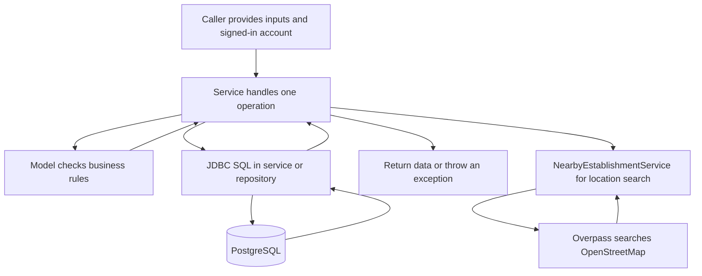
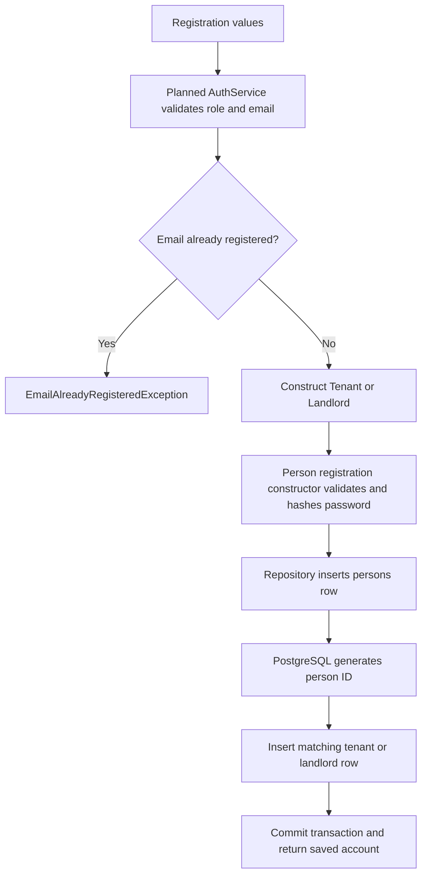
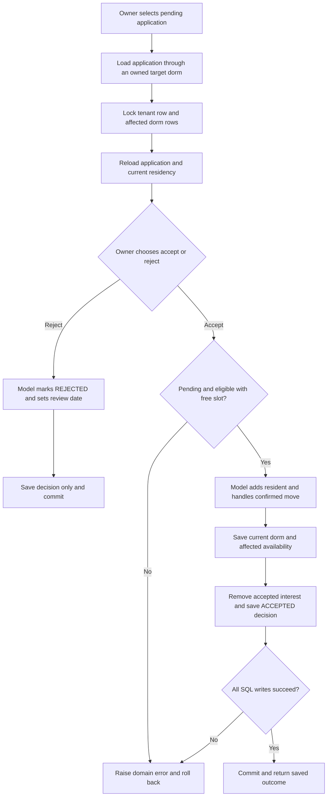
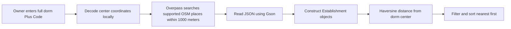

# 2. Understanding the entire backend

Read [Dylan's assigned code](01-dylan-assigned-code.md) first if the Java syntax or individual classes are unfamiliar. This file explains how the backend parts connect. Continue with [the complete system and frontend](03-entire-system-with-frontend.md) to connect these operations to screens.

This is a learning document. It does not change the program or add services, tests, or stubs. All names, IDs, values, and outcomes in the examples are fictional illustrations, not output observed from a running application.

## 1. What is the backend responsible for?

The backend answers questions and applies rules: Who is signed in? Which dorms belong to this landlord? Can this application be accepted? Which announcements can this tenant read? What must be saved if a tenant moves?

The backend receives values from a caller, validates the requested action, reads or changes data, and returns a result or throws an exception. The frontend decides how to display that result.

The intended overall arrangement is:



The **current landlord services contain their SQL directly**. Existing repository classes also exist, particularly for loading/saving accounts and model records. Do not assume every current operation passes through a separate repository method: follow the actual method call in the file.

## 2. Understand the current state before studying the intended flow

Use these labels throughout this document:

- **Written:** the relevant Java logic is present in a source file. This alone does not establish that the whole project compiles or the operation works against a configured database.
- **Planned:** the pasted issue specifies the operation, but its service implementation is absent or empty in the current files.
- **Blocked:** existing compilation or integration problems prevent a complete application run.

| Part | Current source state |
|---|---|
| Core models | Substantial logic is written, including account constructors, residency, applications, announcements, and complaints |
| AuthService and DormService | Their files currently contain no implementation |
| ComplaintService | Its existing file is also empty; it is not an implemented TenantComplaintService |
| InterestService, ApplicationService, TenantHomeService, TenantComplaintService | These named service classes are currently absent |
| Five landlord services | Written in `src/main/service`, with SQL contained in the services |
| NearbyEstablishmentService | Written; uses Plus Code input, Overpass, and local straight-line distance calculation |
| docs/service-api.md | Required by the issues, but currently deleted in the working tree; this learning task does not recreate it |
| Tests and sample stubs | Omitted under the team's later instruction, even though older issue descriptions requested stubs |

The complete project is currently **blocked**. `Dorm`, `Landlord`, and `Tenant` contain duplicate empty declarations before their complete classes. Existing repositories also call missing model methods such as generated-ID setters and a complaint sender accessor. These are descriptions of the current files, not repairs made by this guide.

There are also requirement differences to understand: `Validator.age` currently checks for a minimum of 18 but does not enforce the issue's full 16–120 range; email validation does not lowercase its result; `DormFilter` currently searches a keyword in dorm names and amenities rather than implementing the issue's maximum-rate/location/amenity filter fields. The Person password-hash persistence getter is public, and the issue's equals/hashCode overrides are absent. Read the issue as the target and the source as the current implementation.

The diagrams below describe the intended system workflow and the behavior expressed by written methods. They do not claim all of these service paths can run today.

## 3. How the issues build on each other

| Issue area | Owner | Contribution to the flow |
|---|---|---|
| [05] Landlord/dorm core | Dylan | Shared Person, validation, enums, exceptions, PlusCode, DormDetails, Landlord, Dorm, Announcement, Establishment |
| [06] Student core | Neil | Full Tenant, Application, Complaint, and DormFilter behavior replacing early shells |
| [07] Student service API | Neil | Contracts for authentication, browsing, interests, applications, and tenant home |
| [08] Student browse backend | Neil | Intended persistent registration/login, dorm search, interests, and application submission |
| [09] Student home backend | Neil | Intended persistent current-dorm information, contacts, dormmates, announcements, and complaints |
| [10] Landlord service API | Dylan | Contracts for the five landlord operations; the later no-stubs decision changes the original sample-data requirement |
| [11] Landlord listing backend | Dylan | Listing changes, owner checks, and dashboard totals |
| [12] Landlord communication backend | Dylan | Pending review, acceptance/transfers, rejection, publishing, and private complaint viewing |

The core models supply the rules. The services connect those rules to records that survive closing the application. A method existing in a model does not mean its persistent service is already implemented.

## 4. Objects in memory and rows in PostgreSQL

A `Tenant` Java object exists in application memory. A row in `tenants` exists in PostgreSQL. They represent the same account but have different lifetimes.

Calling `tenant.applyToDorm(...)` creates an Application object and adds it to an in-memory list. To retain it after restart, the intended application service must insert an application row. Similarly, calling `dorm.addTenant(...)` changes Java associations and available slots, while SQL is needed to save current residency.

Closing a connection does not save arbitrary Java objects. Only executed SQL writes affect the database, and an explicit transaction must commit before those writes are treated as saved.

The schema currently defines **11 tables**:

| Table | Persistent information | Related Java concept |
|---|---|---|
| persons | Shared account details, role, password hash, login flag | Person fields inherited by Tenant/Landlord |
| landlords | Landlord account ID and other contact | Landlord |
| tenants | Tenant account ID and current dorm ID, possibly NULL | Tenant.currentDorm |
| dorms | Owner, listing details, capacity, rate, Plus Code, posting date | Dorm and DormDetails |
| dorm_amenities | Amenity strings for each dorm | Dorm.amenities |
| dorm_photos | Photo URL/path strings for each dorm | Dorm.photos |
| interested_dorms | Tenant–dorm interest pairs | Interested dorms and interested tenants |
| applications | Applicant, target dorm, status, transfer confirmation, dates | Application |
| announcements | Dorm, author, message, posting date | Announcement |
| complaints | Dorm, nullable sender, message, anonymous flag, date | Complaint |
| establishments | Stored establishment information | Establishment; separate from temporary live OSM results |

Read the actual table definitions in [schema.sql](../database/schema.sql). The SQL file defines the structure; PostgreSQL stores actual records separately from that file.

An ID such as `dorm_id = 10` connects rows. Java loaders reconstruct associations from those IDs. Loading the same saved user at different times can create different Java objects representing the same database ID.

## 5. Registration: creating a new account

**Planned persistent service:** `AuthService.register(...)`. Account constructors and repository operations provide pieces of this flow, but the AuthService file itself is empty.



Suppose Maria chooses LANDLORD. `new Landlord(...)` starts creating **one Landlord object**. Its call to `super(...)` initializes the Person fields in that same object. It does not create a separate second Person object.

The registration constructor receives the raw password. `Person.setPasswordHash` first calls `Validator.password`, then `PasswordHasher.hash`. The current hasher uses bcrypt with a generated salt and cost 12. The resulting encoded hash contains the information needed for verification, including its salt. The raw password is not a Person field.

Before persistence, a new Person's integer ID is initially 0. [PersonRepository.insertPerson](../src/main/repository/PersonRepository.java) inserts shared fields, obtains the generated key, and assigns it to the object. A role repository saves its corresponding role row on the same transaction. An email pre-check is useful, while PostgreSQL's UNIQUE email constraint is the final protection against duplicate rows.

## 6. Login: loading an existing account

**Planned persistent service:** `AuthService.login(email, password)`.

The service would find the saved role/account by email, use the appropriate repository to reconstruct a Tenant or Landlord, and verify the entered raw password. Database-loading constructors accept the **existing hash** and assign it without hashing it again.

`Person.login(rawPassword)` calls `checkPassword`, which calls `PasswordHasher.matches(rawPassword, storedHash)`. This uses `BCrypt.checkpw`; it does not create a fresh random hash and compare the two hash strings. A fresh salt could make equal passwords produce different encoded hashes.

Wrong credentials should produce AuthenticationException through the planned service/login path. On success, the model sets its in-memory loggedIn flag. The existing PersonRepository has a separate `setLoggedIn` SQL method; saving a database login flag requires an explicit call and is not automatically performed by Person.login. An account ID or a stored Boolean is not a substitute for password authentication.

The resulting model supplies the intended destination through `getDashboardType()`:

| Account condition | DashboardType |
|---|---|
| Landlord | LANDLORD_DASHBOARD |
| Tenant without a current dorm | TENANT_LISTINGS |
| Tenant with a current dorm | TENANT_DORM_HOME |

## 7. Landlord listing management and dashboard

**Written:** [ListingService](../src/main/service/ListingService.java) and [DashboardService](../src/main/service/DashboardService.java).

A ListingService is constructed with the authenticated landlord. It remembers that owner because `updateDorm(id, details)` and `removeDorm(id)` have no landlord parameter. `getMyDorms` and `postDorm` also verify that the supplied account matches this stored account.

Listing access uses `WHERE dorm_id = ? AND owner_id = ?`. A dorm ID received from a caller does not grant access by itself. A different owner's ID and a nonexistent management ID both produce an access exception.

Posting creates a validated Dorm from DormDetails, saves its row and child amenity/photo rows, and returns the saved listing. Updating loads actual residents before calling `Dorm.updateDetails`; reducing capacity below that count fails. Removal checks occupancy in the model and the deletion query. The slot count in a stale caller object is not trusted as the basis for a decision.

The dashboard returns a read-only `Map<String, Integer>`, not a custom summary class. For an illustrative owner with one two-slot dorm and one resident, its values could be:

```text
dormCount = 1
totalSlots = 2
occupiedSlots = 1
availableSlots = 1
pendingApplications = 1
```

The query filters all totals to that owner and counts actual residency through `tenants.current_dorm_id`. A screen reads `totals.get("availableSlots")` to obtain the integer 1.

## 8. Student browsing, filtering, and interest

**Planned services:** DormService and InterestService. The current Tenant and DormFilter models express some relevant behavior.

The intended DormService obtains available listings, returns details for a saved ID, and filters matching dorms. The issue specifies maximum rate, location, and amenities, with null meaning no filter for the corresponding criterion. The current DormFilter instead accepts a keyword and checks dorm names and amenities. These are different contracts; do not describe the richer filter as already implemented.

Interest means bookmarking a listing. `Tenant.markInterested` delegates to `Dorm.addInterest`, which updates both sides' in-memory lists and avoids duplicates. The intended InterestService would persist the pair in `interested_dorms`. Its composite primary key prevents the same tenant/dorm pair from appearing twice in the database.

Interest does not create an application, reserve a place, or change currentDorm. A landlord interest notification remains conditional on approval in [01]; no notification mechanism is implemented here.

## 9. Submitting an application does not reserve a slot

**Written model:** Tenant.applyToDorm and Application constructors. **Planned persistent service:** ApplicationService.applyToDorm and getMyApplications.

The model creates a PENDING Application and adds it to the tenant's list. The intended service must save that pending row. If the tenant already occupies a different dorm, transfer confirmation is required. Submission leaves the old residency unchanged.

```text
Before applying: Dorm B has 2 available slots; tenant occupies Dorm A.
After applying with confirmation: Dorm B still has 2 available slots.
Application: PENDING; reviewed date: absent; current dorm: still Dorm A.
```

Several people can have pending applications for the same remaining slot. The owner must check availability at acceptance time. Submission also does not automatically log the user into a different home screen.

## 10. Acceptance, rejection, and confirmed transfers

**Written:** [ApplicationReviewService](../src/main/service/ApplicationReviewService.java) and [Application](../src/main/model/Application.java), subject to the project's blockers.



The service first loads an application through the landlord's owned dorm. It locks the applicant's tenant row, then the relevant dorm rows in ascending dorm-ID order, then rereads and locks the application. It restores a prior resident object when necessary so `tenant.currentDorm` reflects saved residency before the decision.

`Application.accept(landlord)` checks ownership and pending status again, rejects an existing resident of the target dorm, checks current transfer confirmation, and rejects a full dorm. It calls `Dorm.addTenant`, which updates the Java residency and available slots. A confirmed move removes the previous residency.

The service then writes `tenants.current_dorm_id`, recalculates availability for target and previous dorms, removes interest in the accepted dorm, and saves ACCEPTED/dateReviewed. Rejection writes status/dateReviewed only. A PENDING application cannot already have a review date, and an already-decided application cannot be reviewed again.

Confirmation is rechecked because circumstances can change between submission and review. A tenant who originally had no dorm might have been accepted somewhere else meanwhile.

## 11. Why the connection and transaction matter

`setAutoCommit(false)` groups the SQL writes on one connection. `commit()` saves the group; `rollback()` cancels its database changes on failure.

Consider moving Ana from A to B. Updating her current dorm without updating both dorm capacities would leave inconsistent records. The service groups these updates with the application decision so either all the database writes succeed or none are kept.

`FOR UPDATE` holds relevant row locks until transaction end. Competing acceptance operations using these same locking rules must wait, then reload current state. This prevents both from assuming one final place is still free. Consistent dorm lock order helps avoid two transfers waiting on dorm locks in opposite order.

A SQL rollback does not automatically undo arbitrary Java-object changes. These services load fresh objects during decisions and return success only after committing; the caller should refresh its data after a completed write and should not report a failed operation as saved. The behavior has not been verified through a complete runnable build in the current state.

## 12. Tenant home and announcement visibility

**Planned services:** TenantHomeService and TenantComplaintService. Their corresponding model operations partly exist.

The intended home service loads the tenant's current dorm, landlord phone/email/otherContact, and current dormmates. It should reject all home actions with DormNotFoundException when currentDorm is absent. Hiding a button alone is not this backend check.

Announcement publishing is written in [AnnouncementService](../src/main/service/AnnouncementService.java): reload and lock the owned dorm, construct a validated Announcement, insert it through an owner-filtered query, and return its generated ID and date. The message must be nonempty and at most 1000 characters.

For reading, `Announcement.isVisibleTo(tenant)` compares the announcement dorm with the tenant's current dorm. The planned tenant service must enforce this. The current Tenant.viewAnnouncements model returns its current dorm's in-memory list and returns an empty list when unhoused; that alone does not implement the service requirement to throw DormNotFoundException and load/filter saved announcements.

## 13. Complaint submission and landlord privacy

The intended TenantComplaintService verifies the tenant has the requested current dorm, validates the message, creates a Complaint, and saves it. For anonymous submission, the model verifies the submitting tenant's residency but retains no sender reference; the saved sender_id must also be NULL. Knowing who is making a request for validation is different from recording their identity in the complaint.

For a nonanonymous complaint, the full model can retain the sender. The landlord service requirement still says never expose the sender, so its result is a narrower view of the data.

[LandlordComplaintService](../src/main/service/LandlordComplaintService.java) checks dorm ownership and selects only complaint ID, message, and date. It returns a read-only list of read-only standard maps containing strings:

```text
complaintId = 7
message = Please repair the hallway light.
datePosted = 2026-11-09T18:00:00
```

Those values are illustrative. There is no sender key, no raw Complaint object, and no edit/reply/delete operation in this service. The query does not retrieve sender identity for either complaint kind. The existing general ComplaintRepository has mapping/API problems; the dedicated landlord query does not make that unrelated repository complete.

## 14. Plus Codes and nearby establishments

**Written:** [PlusCode](../src/main/model/PlusCode.java), [Establishment](../src/main/model/Establishment.java), and [NearbyEstablishmentService](../src/main/service/NearbyEstablishmentService.java). The intended DormService.getNearbyEstablishments bridge is not yet implemented.



A full code identifies a geographic area; PlusCode stores its center latitude/longitude. Google's Open Location Code library handles that conversion locally. It does not make a Google Maps request or require a Google API key.

Overpass supplies locations of supported groceries, convenience stores, laundries, pharmacies, and schools/colleges/universities mapped in OpenStreetMap. Establishment calculates approximate center-to-center straight-line meters using haversine. A building outline uses its bounding-box center, which may differ from the entrance. This does not compute roads, walking routes, or travel time.

Live results are temporary Establishment objects with ID 0; the current lookup does not insert them into the establishments table. A successful empty list means no supported mapped results were found. A network failure instead raises an exception. Display OpenStreetMap contributor attribution beside results.

The schema's dorm Plus Code column currently allows only 10 characters, while a standard full code uses 11 including the plus sign. Existing seed codes are short placeholders. These integration gaps are not corrected by this documentation.

## 15. One connected example for the team

Imagine Maria is landlord 1, Jose is landlord 2, Ana is tenant 3, and Ben is tenant 4. Maria owns Dorm A, ID 10, with two total places. Jose owns Dorm B, ID 20. These are learning values.

1. Intended registration/login creates and later reconstructs Ana's Tenant account. Initially, currentDorm is null and her destination is TENANT_LISTINGS.
2. Maria posts A through ListingService. It starts empty with two free places; the SQL stores the listing and child records. Ben is then accepted in an earlier application event, leaving one resident and one free place before Ana applies. Posting a listing itself does not add occupants. Nearby lookup can independently use A's full Plus Code.
3. Ana browses A through the planned student service, marks interest, and applies. Current dorm stays null and A's one remaining free place stays free while the application is PENDING.
4. Maria accepts through ApplicationReviewService. Ana's current dorm becomes 10, A has two residents and zero free places, the application is ACCEPTED with a review date, and the accepted interest is removed.
5. On a fresh load, Ana's dashboard type becomes TENANT_DORM_HOME. The planned home service can provide Maria's contacts, A's dormmates, and A's announcements.
6. Maria publishes an announcement for A. Ana can see it because she currently occupies A. An occupant of B cannot see A's message through the required tenant visibility check.
7. Ana submits an anonymous complaint through the planned complaint service. The saved sender is null; Maria's written complaint service returns only ID, message, and date.
8. Later Ana applies to B with transfer confirmation. She remains in A while pending. If Jose rejects, she stays in A. If Jose accepts while B has a free place, one transaction moves currentDorm to 20, frees one place in A (Ben remains, so A has one resident and one free place), decreases B's availability, and saves the new accepted decision.

An old ACCEPTED application to A can remain as historical information after the move. The current residency is determined by tenants.current_dorm_id, not by treating every accepted application as an active residency.

## 16. Questions to use when explaining the backend aloud

For each operation, identify: who called it, which account is trusted from login, which model rule runs, what rows are read, what rows change, whether a transaction is needed, and what data is returned. If a service is planned, say so explicitly instead of demonstrating an empty file as a completed feature.

For example: “Accepting an application is an owner-authorized decision. Applying only creates a pending request. Acceptance reloads current state, checks capacity, updates residency and slots, and saves the decision together. The caller receives the result after commit.”

That explanation connects the model rules, SQL writes, and service purpose without confusing a Java object with a database row or a requested feature with a completed implementation.
