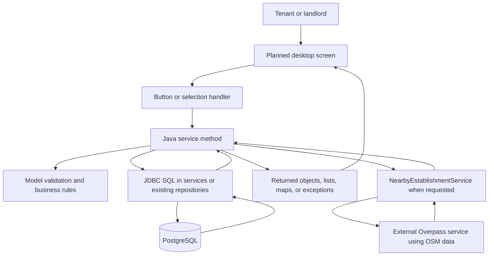
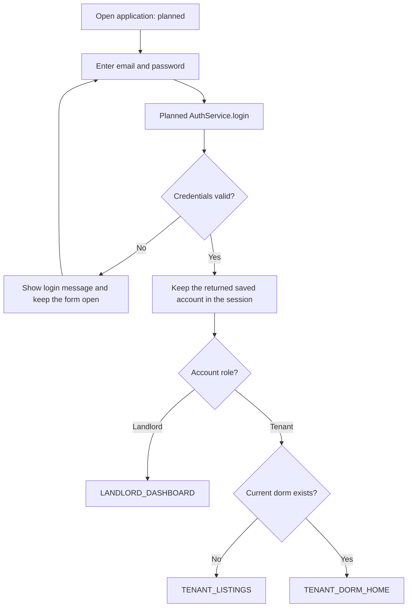

# 3. Understanding the complete system: frontend and backend

Read [Dylan's assigned code](01-dylan-assigned-code.md) first, then [the backend flow](02-entire-backend-flow.md). This file connects those ideas to the screens your team plans to build.

**This is an explanation, not new application code.** The stories and results below are fictional examples showing the intended behavior. They are not results from running the current application.

## 1. What exists now, and what is still planned?

The files in [src/main/ui](../src/main/ui/) currently contain no code. [Main.java](../src/main/Main.java) is also empty. The screen names suggest a desktop panel-based interface, but there is no implemented application window or button wiring to demonstrate yet.

| Area | Current state |
|---|---|
| `MainFrame.java`, `LoginPanel.java` | Empty frontend placeholders |
| Tenant `BrowsePanel`, `ComparePanel`, `ComplaintPanel` | Empty frontend placeholders |
| Landlord `ListingFormPanel`, `ComplaintInboxPanel` | Empty frontend placeholders |
| Components `DormCard`, `MapPanel` | Empty frontend placeholders |
| Five landlord service classes | Java logic is written; the complete project still has compilation blockers |
| `NearbyEstablishmentService` | OSM request and distance-handling code is written; no map panel is connected |
| `AuthService`, `DormService`, `ComplaintService` | Empty files |
| Other student services named in the issues | Not currently present under those names |
| `docs/service-api.md` | Currently absent from the working files |

The existing duplicate declarations in Dorm, Landlord, and Tenant, together with model/repository API mismatches, prevent a complete build. This guide explains both the written logic and the intended finished flow; it does not claim the system currently runs end to end. Tests and sample-service stubs are omitted following the team's decision.

## 2. Frontend and backend are two jobs within the application

The **frontend** displays forms, buttons, lists, and messages. It collects an action such as “publish this announcement.”

The **backend** checks whether the action is allowed, applies the model rules, and reads or saves data. PostgreSQL retains records after the Java program closes.

A Swing-style desktop frontend would normally call these Java service methods directly. The current project does not contain an HTTP server or REST endpoints between its own screens and services. The OpenStreetMap lookup is different: the Java program makes an external HTTP request to Overpass.



An object changing in memory is not automatically saved in PostgreSQL. A screen must call an operation that performs the necessary database writes. A database write also does not automatically redraw an open screen; the frontend must refresh its displayed values.

## 3. Registration and login are different screens or actions

| Registration collects | Login collects |
|---|---|
| Name, age, Philippine mobile number | Email |
| Email and raw password | Raw password |
| Role: tenant or landlord | No new profile details |
| Optional landlord other contact through the landlord-specific form/profile flow | The saved account determines its role |

The register signature listed in the issue does not include otherContact, although the Landlord model supports it. The frontend and authentication owner need to agree how the optional landlord field is passed or updated. This document does not invent an implemented extra service method.

The intended registration flow is:

1. The user enters the form values and clicks Register.
2. The frontend checks that it can read values, such as converting the age text to a number. Authoritative validation still belongs in the backend.
3. The planned AuthService checks the email and creates a Tenant or Landlord object.
4. Its superclass constructor initializes the shared Person fields and hashes the raw password. `super(...)` initializes the same subclass object; it does not create a separate standalone Person account.
5. The repository inserts the person and the matching tenant/landlord row. PostgreSQL generates the person ID.
6. The frontend shows success only after saving succeeds.

The intended login flow loads an existing account using its database constructor. That constructor receives the stored hash without hashing it again. `Person.login(rawPassword)` checks the password through PasswordHasher; bcrypt verifies using the salt/cost already encoded in the stored hash. The frontend never needs to display or compare password hashes.

These AuthService flows are planned: its current file is empty. Registration is expected to handle duplicate emails; login is expected to produce AuthenticationException for invalid credentials. The issue's required age range is 16–120, while the current Validator differs; the first guide identifies that mismatch rather than presenting the form as already compliant.



The values come from [DashboardType.java](../src/main/enums/DashboardType.java) and the subclass `getDashboardType()` methods. The frontend chooses a screen using the saved account's state. An account ID supplied in an editable field is not authentication.

## 4. A landlord posts a dorm

Consider Maria, a fictional landlord with person ID 1. Her planned listing form collects:

- Dorm name, location text, and the dorm's full Plus Code.
- Description, total slots, monthly rate, amenities, rules, and photo references.

Maria does not type her database owner ID or the posting date. The service uses the signed-in Landlord object, and the program/database supplies IDs and dates. At creation there are no residents, so availability starts equal to total slots. In the shared example, Maria posts dorm 10 with two free slots. Ben, tenant ID 4, is accepted in an earlier event before Ana begins browsing; this leaves one free slot. Posting itself does not create Ben's residency.

The future [ListingFormPanel](../src/main/ui/landlord/ListingFormPanel.java) would turn form values into DormDetails and call:

```java
ListingService listings = new ListingService(maria);
Dorm saved = listings.postDorm(maria, details);
```

This is an illustration of the existing service API, not a complete button handler. The form values, saved Maria object, exception handling, and background work must be supplied by the frontend.

[ListingService](../src/main/service/ListingService.java) validates the owner, constructs a Dorm, and writes the listing, amenities, and photos in a transaction. On success the screen can add the returned dorm to its list or reload `getMyDorms(maria)` and refresh the dashboard.

Photo references in `dorm_photos` do not store image bytes. The existing FileStorage file is empty, so choosing, copying, or loading local image files is a separate unfinished integration. The nearby service also does not display a map by itself; MapPanel is empty.

For an edit, the frontend sends a saved dorm ID and new DormDetails. The backend reloads the dorm using its ID and owner ID, including actual residents. A listing with two residents cannot be reduced to one slot. For removal, an occupied dorm produces a validation message and remains saved.

Hiding an Edit button in the frontend is useful, but backend owner checks remain essential because the service must validate every requested dorm ID.

## 5. A tenant browses, expresses interest, and applies

Ana is a fictional tenant with person ID 3 and no current dorm. Her intended first screen is the tenant listings view. Its planned DormService supplies available dorms and details. BrowsePanel would render cards using that data.

The current DormFilter performs keyword matching on the dorm name and amenities. The issue asks for maximum rate, location, and amenities as optional filters; those complete filters should be understood as a remaining requirement, not existing UI controls with a finished implementation.

Interest and application are different actions:

| Action | Intended result | Slots/residency |
|---|---|---|
| Mark interested | Add an interest association, without duplicates | Unchanged |
| Remove interest | Remove that association | Unchanged |
| Apply | Save a PENDING application and its submission date | Unchanged |
| Landlord accepts | Save ACCEPTED and review date; establish residency | Updated after successful commit |
| Landlord rejects | Save REJECTED and review date | Unchanged |

The planned InterestService and ApplicationService bridge the tenant screens to the existing model/repository behavior. Those service classes are not currently present. Calling `Tenant.applyToDorm()` creates an application in memory; a persistence operation is still required to retain it after closing the program.

Suppose Maria's dorm 10 has two total slots and Ben already occupies one. Ana applies. The screen should show **Pending**. Available slots stay at one. A pending application is not a reservation and does not grant access to resident-only home actions.

The empty ComparePanel suggests a comparison screen, but no dedicated comparison service is defined in the supplied issues. A planned comparison screen could display selected dorm details side by side using available detail data; this guide does not claim that screen or logic exists.

## 6. The landlord makes the decision

Maria selects dorm 10 in her planned application-review view. `ApplicationReviewService.reviewApplications(maria, dorm)` reloads the owned dorm and returns its pending applications.

For acceptance, the frontend passes the application ID. The service restores current records, checks owner/status/capacity/transfer confirmation, uses the model's acceptance rules, and saves the related writes together. It commits before reporting success. Rejection changes the decision and review date without moving Ana.

```mermaid
flowchart TD
    Apply["Tenant submits an application: planned student service"] --> Pending["PENDING; slots and current dorm unchanged"]
    Pending --> Review["Owner opens pending applications"]
    Review --> Decision{"Owner decision?"}
    Decision -->|Reject| Reject["Save REJECTED and review date"]
    Reject --> Stay["Current dorm and slots unchanged"]
    Decision -->|Accept| Check{"Owner, pending, free slot and transfer rules valid?"}
    Check -->|No| Failure["Return an error; no successful move"]
    Check -->|Yes| Transaction["Change residency and affected slots; save ACCEPTED and date"]
    Transaction --> Written{"All writes succeed?"}
    Written -->|No| Rollback["Roll back database writes"]
    Written -->|Yes| Commit["Commit transaction"]
    Commit --> Refresh["Reload application status, listings, dashboard and tenant home data"]
```



If Ana is accepted into dorm 10, its occupied count becomes two and available count becomes zero: Ben and Ana are now its residents. The landlord screen can refresh its totals immediately. Ana's separate open screen will not receive an automatic update because no live notification/push mechanism exists. It must reload her current data on refresh, navigation, or a later login through the completed student services.

## 7. Tenant home after acceptance

The planned TenantHomeService would provide Ana's dorm, the landlord's phone/email/other contact, dormmates such as Ben, and announcements. Tenants without a dorm must receive DormNotFoundException for home actions according to the issue.

The service must verify that an announcement is visible to the requesting tenant using `Announcement.isVisibleTo(tenant)`. The current Tenant model's `viewAnnouncements()` returns its current dorm's list; that model method alone does not implement the complete database-backed service requirement.

Maria can publish an announcement through the written [AnnouncementService](../src/main/service/AnnouncementService.java). The model validates the message and owner; the service reloads an owned dorm and saves the announcement with its ID/date.

```mermaid
sequenceDiagram
    actor Maria as Landlord
    participant UI as Planned announcement form
    participant Service as AnnouncementService
    participant Model as Announcement model
    participant DB as PostgreSQL
    Maria->>UI: Enter message and click Publish
    UI->>Service: publish(savedLandlord, dorm, message)
    Service->>DB: Load owned dorm within a transaction
    Service->>Model: Construct validated announcement
    Model-->>Service: Announcement or validation error
    Service->>DB: Insert using owned dorm and return ID/date
    Service->>DB: Commit after success
    Service-->>UI: Saved announcement
    UI-->>Maria: Display success and refresh
    Note over UI,DB: On failure, service rolls back; UI shows an error instead
```

## 8. Complaints: two privacy boundaries

The planned tenant complaint screen accepts a required message and an anonymous choice. The planned TenantComplaintService must confirm the tenant lives in that dorm before submission.

If Ana chooses anonymous, the Complaint model retains no sender reference, and the database must store `sender_id = NULL`. Choosing nonanonymous permits the tenant persistence path to retain the sender; it does not change the landlord service's rule.

The written [LandlordComplaintService](../src/main/service/LandlordComplaintService.java) returns only these string-valued map keys:

```text
complaintId
message
datePosted
```

It does not select sender identity, even for nonanonymous complaints. ComplaintInboxPanel should display the date and message from this result. It must not load raw Complaint/account records to recover the identity. The service provides read-only viewing, without reply, edit, or delete operations.

## 9. What the current service results look like to a screen

DashboardService returns a read-only `Map<String, Integer>` with keys `dormCount`, `totalSlots`, `occupiedSlots`, `availableSlots`, and `pendingApplications`. For Maria's one two-slot dorm after Ana's acceptance, an illustrative result is:

```text
dormCount = 1
totalSlots = 2
occupiedSlots = 2
availableSlots = 0
pendingApplications = 0
```

A future UI reads `totals.get("availableSlots")` for the available-slot label. For a complaint result it reads `complaint.get("message")` and `complaint.get("datePosted")`. Dashboard values are integers; complaint values are strings, including the complaint ID and ISO local date-time. Neither result uses the removed DashboardSummary or ComplaintView classes.

## 10. Nearby establishments and the full Plus Code

The owner supplies only the dorm's full Plus Code for this location feature. The address remains a separate text description. The existing NearbyEstablishmentService decodes the code locally, asks Overpass for supported OSM places within 1000 meters, converts their coordinates into establishment objects, and sorts by approximate straight-line distance.

Supported categories include stores, groceries, laundries, schools/colleges/universities, and pharmacies. The UI would show a name, category, and distance in meters. It should label the result **straight-line distance**. Walls, entrances, roads, and one-way restrictions are not used to calculate that number.

OSM lookup uses internet; PostgreSQL listing saves are a separate operation. A search failure should leave dorm details visible and provide a retry/refresh message. A valid empty result means no supported mapped places were found, not proof that the real area has no establishments. Display OpenStreetMap contributor attribution and the copyright link beside live results. Google APIs were discussed earlier, but this written implementation uses OSM and does not calculate driving or walking routes.

## 11. A confirmed transfer and a complete fictional story

Continue the example: Maria owns dorm 10; Ana currently lives there. Jose, owner ID 2, offers dorm 20 with one free slot.

Ana applies to dorm 20 with transfer confirmation. She remains in dorm 10 while waiting. Maria's old dorm must not lose a resident merely because Ana clicked Apply.

If Jose rejects, Ana stays in dorm 10. If Jose accepts, the transaction changes Ana's current dorm to 20, makes dorm 20 full, frees Ana's place in dorm 10, and saves the acceptance date. Ben stays in dorm 10, so it then has one occupied slot and one available slot. A failed transaction keeps the previous database state.

After refreshing, Ana's home displays Jose's dorm and contact data. Announcements from Maria's dorm are no longer visible through the resident-only home flow. Maria sees her available count increase after her own refresh. No automatic email, messaging, payment, or interest-notification system is established by these issues; interest notifications require separate approval in [01].

## 12. Screen action to backend and stored data

| Planned screen action | Method/flow | Main stored data | Screen receives |
|---|---|---|---|
| Register / log in | Planned AuthService | persons plus landlords/tenants | Saved account or error |
| Browse / filter / details | Planned DormService | dorms, amenities, photos | Dorm data |
| Mark/remove interest | Planned InterestService | interested_dorms | Updated interest state |
| Apply / view my applications | Planned ApplicationService | applications | Pending/status data |
| Open resident home | Planned TenantHomeService | tenants, dorms, persons, announcements | Own-dorm home data |
| Submit complaint | Planned TenantComplaintService | complaints | Saved complaint or error |
| Post/edit/remove listing | Written ListingService | dorms, amenities, photos | Saved Dorm or completion/error |
| Refresh landlord dashboard | Written DashboardService | Owned dorms, residents, applications | Totals map |
| Accept/reject | Written ApplicationReviewService | applications, tenants, dorms, accepted interest | Updated Application |
| Publish announcement | Written AnnouncementService | announcements | Saved Announcement |
| Read landlord complaints | Written LandlordComplaintService | Owner-filtered complaints | Sender-free maps |
| Show nearby places | Written NearbyEstablishmentService | External OSM search; no result rows saved | Establishments/distances |

“Written” identifies source logic that exists; it does not mean the compile-blocked project or its absent screens were demonstrated working.

## 13. Keeping the future interface responsive and understandable

In a Swing implementation, button handlers run on the event-dispatch thread. Database and network work should be moved to a background task, for example SwingWorker, then its result displayed on the UI thread. Otherwise a slow connection would freeze painting, clicks, and typing. This is an explanation of the intended integration, not new threaded code in the project.

While an operation runs, the frontend can disable the relevant action and show loading. After success it refreshes the affected data. After failure it keeps useful form input and shows the appropriate message. InvalidInputException explains validation/business rules; UnauthorizedActionException explains access; NoAvailableSlotsException explains a full target; DormNotFoundException explains unavailable home actions. SQL/network failures need a useful user message without exposing passwords, hashes, connection secrets, or raw stack traces.

The team can walk through one action at a time: identify what the screen collects, which method receives it, which rule runs, which rows change, and what is displayed after the result. That chain is the connection between frontend and backend throughout Find-The-D.
