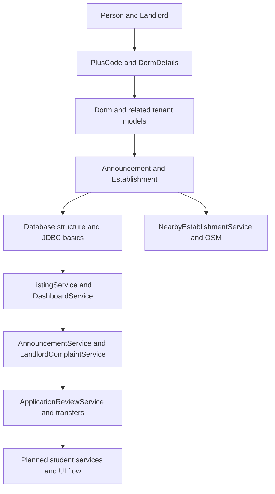

# The order to understand the files

This is your reading roadmap. Start with **Person**, then **Landlord**, then
follow the related models before studying the services.

The detailed explanations are in [01-dylan-assigned-code.md](01-dylan-assigned-code.md).
After understanding the files, read [the backend flow](02-entire-backend-flow.md)
and [the frontend-to-backend flow](03-entire-system-with-frontend.md).

**Study order and execution order are different.** Java does not run Person.java,
then Landlord.java, then Dorm.java simply because you read them in that order.
Methods call other methods when an action occurs. Some classes reference each
other, so you will revisit an earlier file after understanding a later one.

## 1. Your main model-reading sequence

```text
Person
  -> Landlord
  -> PlusCode
  -> DormDetails
  -> Dorm
  -> Tenant
  -> Application
  -> Announcement
  -> Complaint
  -> Establishment
```

Read Tenant, Application, and Complaint to understand how your landlord code
interacts with Neil's models. Studying them does not assign their implementation
to you. These are existing files, not instructions to create additional classes.

| Order | File to open | Focus first | Understand this before continuing |
|---|---|---|---|
| 1 | [Person.java](../src/main/model/Person.java) | Fields, registration constructor, saved-data constructor, login/logout, checkPassword | Which values are shared by every account? Why is a raw password hashed only during registration? |
| 2 | [Landlord.java](../src/main/model/Landlord.java) | extends Person, super, otherContact, handledDorms, ownsDorm | How does one Landlord object inherit account state? How does it identify an owned dorm? |
| 3 | [PlusCode.java](../src/main/model/PlusCode.java) | Full-code validation, decoding, latitude/longitude getters | How does location text become coordinates? |
| 4 | [DormDetails.java](../src/main/model/DormDetails.java) | Constructor inputs, validation, getters | What values are grouped when posting or editing a dorm? |
| 5 | [Dorm.java](../src/main/model/Dorm.java) | Constructors, residents, total/available slots, updateDetails, addTenant/removeTenant | What changes when someone joins, leaves, or a landlord changes capacity? |
| 6 | [Tenant.java](../src/main/model/Tenant.java) | currentDorm, hasDorm, applyToDorm, interestedDorms, getDashboardType | Why does applying leave residency and available slots unchanged? |
| 7 | [Application.java](../src/main/model/Application.java) | Status, transferConfirmed, accept/reject, review date | Who decides an application, and when does a pending request become a residency? |
| 8 | [Announcement.java](../src/main/model/Announcement.java) | Owner check, message, posting date, isVisibleTo | Who may publish, and which tenant may see the result? |
| 9 | [Complaint.java](../src/main/model/Complaint.java) | Private sender, anonymous construction, message/date | What does anonymous mean in memory and in saved data? |
| 10 | [Establishment.java](../src/main/model/Establishment.java) | Plus Code location, distanceFrom, isNear | What does straight-line distance measure, and what does the 1000-meter limit mean? |

After Dorm, revisit Landlord.postDorm and Landlord.manageDorm. Their use of
DormDetails and Dorm should now make sense. After Application, revisit the
landlord's acceptance/rejection methods.

### What to do when Person refers to an unfamiliar file

You can start Person without first mastering every imported class. When you
meet one of these calls, take a short detour and then return to Person:

| Reference you encounter | File(s) to read | Why |
|---|---|---|
| Role.LANDLORD or Role.TENANT | [Role.java](../src/main/enums/Role.java) | The allowed account choices |
| getDashboardType | [DashboardType.java](../src/main/enums/DashboardType.java) | The destination area chosen from account state |
| Validator.name/age/email/password | [Validator.java](../src/main/util/Validator.java) | Checks and sometimes cleans the incoming value |
| PasswordHasher.hash/matches | [PasswordHasher.java](../src/main/util/PasswordHasher.java) | Creates or verifies the stored bcrypt password string |
| throws or throw | [exception folder](../src/main/exception/) | Named errors that move back to the caller |

Later, read [ApplicationStatus.java](../src/main/enums/ApplicationStatus.java)
with Application, and [EstablishmentType.java](../src/main/enums/EstablishmentType.java)
with Establishment.

## 2. Understand the constructors in this order

First trace a new account:

```text
Caller creates new Landlord with a raw password
  -> Landlord registration constructor
  -> Person registration constructor through super
  -> Validator checks the fields
  -> PasswordHasher hashes the raw password
  -> One initialized Landlord object exists in memory
```

This creates one object. super initializes the inherited part of that same
Landlord. A repository must still save it; a constructor does not issue SQL.

Next trace loading an existing account:

```text
Repository reads the saved database row
  -> Landlord saved-data constructor receives ID and saved hash
  -> Person saved-data constructor through super
  -> Existing hash is assigned directly
  -> Loaded Landlord object represents the saved account
```

Next study Dorm's new-listing constructor, then its saved-listing constructors.
The saved constructor accepting residents is essential for occupied dorms.
Follow that constructor into Tenant.currentDorm restoration.

Finally study Announcement's new/saved constructors and Application's
new/saved constructors. The repeated pattern is **new data versus data already
stored in the database**, not two different users or two simultaneous accounts.

## 3. Read the database-supporting files before the services

These files explain how data is stored and loaded. Read them for understanding;
this roadmap does not ask you to edit teammate-owned code.

| Order | File | What to learn |
|---|---|---|
| 11 | [schema.sql](../database/schema.sql) | Primary keys, foreign keys, owner_id, current_dorm_id, status, and the child tables |
| 12 | [Env.java](../src/main/util/Env.java) | How local settings are obtained, without sharing real credentials |
| 13 | [DatabaseConnection.java](../src/main/util/DatabaseConnection.java) | How Java opens a PostgreSQL connection |
| 14 | [PersonRepository.java](../src/main/repository/PersonRepository.java) | How a person row is inserted and a generated ID is assigned |
| 15 | [LandlordRepository.java](../src/main/repository/LandlordRepository.java) | How saved account columns become a Landlord object and how the role row is saved |

Then briefly inspect [TenantRepository.java](../src/main/repository/TenantRepository.java),
[DormRepository.java](../src/main/repository/DormRepository.java),
[ApplicationRepository.java](../src/main/repository/ApplicationRepository.java),
[AnnouncementRepository.java](../src/main/repository/AnnouncementRepository.java),
and [ComplaintRepository.java](../src/main/repository/ComplaintRepository.java).
Notice the same JDBC vocabulary: Connection, PreparedStatement, placeholders,
ResultSet, and generated IDs. You do not need to memorize all their CRUD methods
before continuing.

**Current code detail:** the five landlord services now contain their own SQL
after the extra landlord repository was removed. Reading the existing
repository files helps explain persistence, but their methods are not called
by every current landlord-service operation.

## 4. Your landlord service-reading sequence

```text
ListingService
  -> DashboardService
  -> AnnouncementService
  -> LandlordComplaintService
  -> ApplicationReviewService
```

| Order | Assigned service file | Why this position? | Main question |
|---|---|---|---|
| 16 | [ListingService.java](../src/main/service/ListingService.java) | Other services reuse its actor checks and owned-dorm loading; it also introduces transactions | How is an owner's request checked, loaded, changed, and saved? |
| 17 | [DashboardService.java](../src/main/service/DashboardService.java) | A small read-only operation after understanding ownership and SQL | How are owner-only totals returned as a standard map? |
| 18 | [AnnouncementService.java](../src/main/service/AnnouncementService.java) | A short write flow using a model you already studied | How do owner checking, message validation, saving, and commit fit together? |
| 19 | [LandlordComplaintService.java](../src/main/service/LandlordComplaintService.java) | A read-only flow with restricted output | Which columns reach the landlord, and why is sender identity excluded? |
| 20 | [ApplicationReviewService.java](../src/main/service/ApplicationReviewService.java) | Combines ownership, several models, locks, residency changes, and multiple SQL writes | Why must a placement or confirmed transfer succeed as one complete transaction? |

There are no separate DashboardSummary, ComplaintView, or LandlordAccess files
to study in the current source. Dashboard results use Map<String, Integer>;
landlord complaints use List<Map<String, String>>. Their current fields and
examples are explained in guide 01.

### Inside ListingService: do not read every helper at once

First read the constructor and the four public operations to understand the
available actions. Then follow one action and only the helpers it calls.

**Start with listing dorms:**

```text
getMyDorms
  -> requireCurrentLandlord
  -> findMyDorms
  -> readDorm for each SQL row
       -> readStrings for amenities and photos
       -> readResidents -> readTenant
       -> saved Dorm constructor with residents
  -> Return read-only list
```

**Then study posting:**

```text
postDorm
  -> requireCurrentLandlord
  -> Begin transaction
  -> new Dorm(owner, details)
  -> insertDorm -> setDetails -> insert row and obtain ID
       -> replaceLists -> replaceStrings
  -> Commit and return saved Dorm
```

Finally trace updateDorm and removeDorm. Both load the target through
findOwnedDorm before changing it. The public updateDorm(int, DormDetails) and
private updateDorm(Connection, Dorm) are overloads, not the same method calling
itself forever.

### Inside AnnouncementService: practice one complete write

```text
publish
  -> Check saved actor, dorm reference, and ID
  -> Begin transaction
  -> ListingService.findOwnedDorm
  -> new Announcement applies message/owner rules
  -> insertAnnouncement saves and returns ID/date
  -> Attach to the freshly loaded Dorm
  -> Commit and return the saved Announcement
```

Trace its error path separately: failed validation or SQL -> rollback ->
exception to caller. The UI still needs to catch/display the error later.

### Inside ApplicationReviewService: break it into three passes

1. Read reviewApplications and its SELECT helpers. Understand PENDING and owner
   filtering before reading any transfer code.
2. Read rejectApplication, loadForReview, and saveDecision. Notice rejection
   saves the decision/date without changing residency or slot counts.
3. Read acceptApplication, then Application.accept and Dorm.addTenant, then
   return to the service's database writes.

The acceptance path is:

```text
acceptApplication
  -> loadForReview
       -> findOwnedApplication
       -> lockTenantCurrentDorm
       -> lockDorms in a consistent ID order
       -> Restore previous residency when present
       -> Reload and lock the owned application
  -> Application.accept
       -> Dorm.addTenant
       -> Remove previous residency when it is a confirmed move
  -> updateCurrentDorm
  -> refreshAvailability for affected dorms
  -> removeAcceptedInterest
  -> saveDecision
  -> Commit
```

Study the Java-object changes and the SQL writes as two separate parts of the
same operation. Calling Dorm.addTenant alone does not persist every related
database value.

## 5. Study the nearby-establishment feature as a separate path

Once you understand PlusCode and Establishment, open
[NearbyEstablishmentService.java](../src/main/service/NearbyEstablishmentService.java).

```text
PlusCode
  -> Establishment.distanceFrom
  -> NearbyEstablishmentService
       -> findNearby
       -> buildQuery
       -> Send HTTP request to Overpass
       -> readResults -> readPlace -> category
       -> Filter within 1000 meters and sortNearestFirst
  -> Return establishments with computable straight-line distances
```

This does not require mastering PostgreSQL first. The live lookup is an
external OSM request; it does not save its result objects to the database.
Saving/editing dorms and retrieving nearby establishments are separate actions.

## 6. Where the rest of the team fits

After understanding your models and services, use the second guide to study
Neil's intended AuthService, DormService, InterestService, ApplicationService,
TenantHomeService, and TenantComplaintService flows. Several named services are
currently empty or absent, so there is no full implementation to follow yet.

### Quick service descriptions

**Neil — intended student services:**

- **AuthService** — Registers users and verifies login credentials.
- **DormService** — Retrieves dorm listings, filtered results, details, and nearby establishments.
- **InterestService** — Adds, removes, and retrieves a tenant's interested dorms.
- **ApplicationService** — Submits pending applications and retrieves the tenant's applications.
- **TenantHomeService** — Retrieves the tenant's current dorm, landlord contacts, dormmates, and announcements.
- **TenantComplaintService** — Submits complaints about the tenant's current dorm, including anonymous complaints.

These phrases describe the required responsibilities; several student services
are still empty or absent in the current source.

**Dylan — landlord services:**

- **ListingService** — Creates, retrieves, updates, and removes the landlord's own dorm listings.
- **DashboardService** — Summarizes owned dorms, occupancy, available slots, and pending applications.
- **AnnouncementService** — Publishes announcements for dorms owned by the landlord.
- **LandlordComplaintService** — Retrieves complaints for owned dorms without exposing senders.
- **ApplicationReviewService** — Reviews, accepts, or rejects applications, including confirmed transfers.

Then read the third guide for the planned MainFrame, LoginPanel, listing forms,
browsing, tenant home, application decisions, announcements, and complaint
screens. Main.java and the existing UI files are currently empty placeholders.



This chart shows a learning sequence, not an automatic program-execution order.

## 7. How to know you understand a file

Before moving on, explain these four points aloud in your own words:

1. What data or arguments does this class/method receive?
2. What rule or access check does it enforce?
3. What changes in memory, and what is saved through SQL?
4. What value returns to the caller, or which exception stops the operation?

For example: "Person initializes the shared account fields. Landlord inherits
them and adds owner behavior. DormDetails carries validated listing inputs.
Dorm applies occupancy rules. ListingService loads the owned saved record and
coordinates the SQL write. The planned screen displays the returned result."

The compile/integration blockers described in guide 01 still apply. Reading a
class's intended logic does not mean the current project can already run it.
This file only adds an explanation; it does not repair or change those classes.
