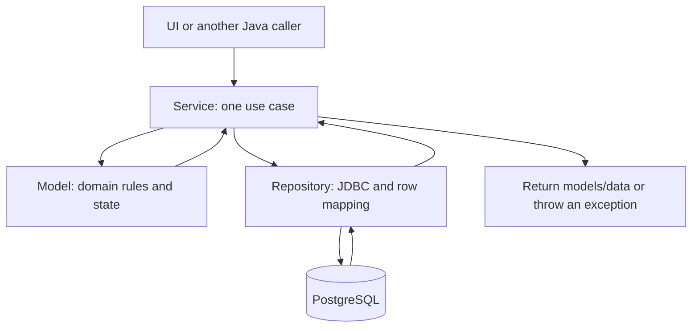
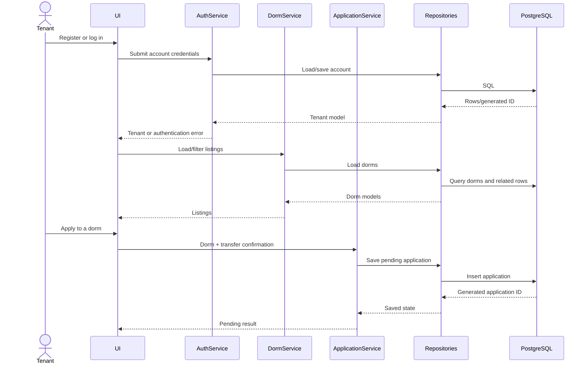

# Complete learning path: your backend to the whole system

This guide follows the order you asked for:

1. Understand the code assigned to you.
2. Understand the whole backend.
3. Understand how the backend connects to the frontend.
4. Understand how a complete user flow works across both.

It describes the current source tree and separates code that already exists
from work that is still required. It does not add stubs or perform the
documentation/testing tasks your group agreed to skip.

## Important: use the current source tree

The current Java packages are directly under `src`:

```text
src/
  enums/
  exception/
  model/
  repository/
  service/
  ui/
  util/
```

Some older files in `dylan-learning` refer to `src/main/...` and describe
services as implemented. Those statements do not match the current checkout.
Use this guide and the Java source itself for current paths and status.

Current code facts to keep in mind:

- The landlord model and database repositories contain substantial code.
- The five Java files in `src/service` are empty. The assigned service
  operations are requirements, not implemented services.
- `Landlord.reviewApplications` currently throws
  `UnsupportedOperationException`; it does not load applications from the DB.
- `DormRepository` has general CRUD methods but no owner-scoped dorm query.
- `ApplicationRepository` can load pending applications by dorm, but a service
  must still authorize the landlord and persist a complete decision.
- `FindTheDUI` is a large standalone Swing prototype. It does not import or call
  the model, repository, or service packages.
- The separate `src/ui/MainFrame.java` and `src/ui/LoginPanel.java` files are
  empty. `src/Main.java` is empty; the prototype entry point is
  `ui.FindTheDUI.main`.
- PostgreSQL schema and repository code exist, but that alone does not prove
  each operation works against a configured database.

## Stage 1 — Understand the code assigned to you

Your main open backend assignments are [#30, listing and dashboard](https://github.com/ivOfFade/Find-The-D/issues/30)
and [#31, applications and landlord communication](https://github.com/ivOfFade/Find-The-D/issues/31).
Issue #29 for stubs is closed, and your group agreed not to make stubs. Learn
the real models and database code first, then implement the real services.

### 1.1 Start with Java concepts used throughout the code

| Term | Find-The-D example |
|---|---|
| Class and object | `Dorm` is a class; `new Dorm(...)` creates one listing object. |
| Field | `Dorm.availableSlots` stores a value on that object. |
| Constructor | A `Dorm` constructor validates and initializes a listing. |
| Method | `dorm.addTenant(tenant)` asks the dorm to enforce admission rules. |
| Package | `package model;` corresponds to `src/model/`. |
| Import | `import model.Dorm;` lets another package refer to `Dorm`. |
| Exception | `NoAvailableSlotsException` tells a caller why admission failed. |
| Collection | `List<Tenant>` holds resident objects. |
| `null` | A tenant with no current dorm has `currentDorm == null`. |
| `Optional<T>` | A repository lookup can return either a model or no row. |

When reading a method, identify its inputs, validation, side effects, result,
and possible exceptions. For example, an object constructor can validate data,
but it does not automatically write that object to PostgreSQL.

### 1.2 Read the domain models in this order

| Order | File | What to understand |
|---|---|---|
| 1 | [Person.java](../src/model/Person.java) | Shared account state, registration versus database-loading constructors, password hashing/checking, IDs, login state. |
| 2 | [Landlord.java](../src/model/Landlord.java) | `ownsDorm`, `postDorm`, `manageDorm`, `removeDorm`, announcements, complaints, and the unfinished `reviewApplications`. |
| 3 | [DormDetails.java](../src/model/DormDetails.java) | Validated inputs used when posting or editing a listing. |
| 4 | [Dorm.java](../src/model/Dorm.java) | Owner, residents, capacity, availability, interests, announcements, complaints, and read-only list getters. |
| 5 | [Tenant.java](../src/model/Tenant.java) | Current dorm, applications, interests, dashboard selection, and complaint creation. |
| 6 | [Application.java](../src/model/Application.java) | `PENDING`/`ACCEPTED`/`REJECTED`, transfer confirmation, ownership checks, admission rules, and review dates. |
| 7 | [Announcement.java](../src/model/Announcement.java) | Owner validation, author, message, posting date, and tenant visibility. |
| 8 | [Complaint.java](../src/model/Complaint.java) | Sender, anonymous behavior, message, date, and persistence ID. |
| 9 | [Validator.java](../src/util/Validator.java) | Shared validation invoked by model constructors and methods. |
| 10 | [ApplicationStatus.java](../src/enums/ApplicationStatus.java) and the other enums | Allowed role, dashboard, application, and establishment values. |

Important behavior already in the models:

- A new unsaved object uses ID `0`; database-generated IDs are assigned after a
  successful insert.
- `Dorm.addTenant` prevents duplicate admission, checks the tenant's current
  dorm and available capacity, updates the resident list and slot count, and
  removes the tenant's interest.
- `Dorm.updateDetails` must not reduce capacity below the resident count.
- `Landlord.removeDorm` rejects an occupied dorm at the model level.
- A new tenant application is pending. Applying does not itself reserve a slot
  or move the tenant.
- `Application.accept` checks ownership, pending status, transfer consent, and
  capacity; it changes the in-memory dorm/tenant/application objects.
- `Application.reject` changes the decision and review date without changing
  the tenant's current dorm.
- An anonymous `Complaint` has a null sender in the model. A service must not
  expose sender data to the landlord.

These are in-memory rules. The service and repository must still save the
resulting changes to PostgreSQL.

### 1.3 Understand the repository layer

Read [RepositoryInterface.java](../src/repository/RepositoryInterface.java)
first for the common CRUD shape, then follow these concrete classes:

| Repository | Main responsibility |
|---|---|
| [PersonRepository.java](../src/repository/PersonRepository.java) | Account-role/email lookups and login-state persistence. |
| [LandlordRepository.java](../src/repository/LandlordRepository.java) | Load and persist landlord/person records. |
| [TenantRepository.java](../src/repository/TenantRepository.java) | Load and persist tenants, including current-dorm association. |
| [DormRepository.java](../src/repository/DormRepository.java) | Load/save dorms and their amenity/photo rows and residents. |
| [ApplicationRepository.java](../src/repository/ApplicationRepository.java) | Load applications, find pending applications, and update a decision. |
| [AnnouncementRepository.java](../src/repository/AnnouncementRepository.java) | Save and query announcements. |
| [ComplaintRepository.java](../src/repository/ComplaintRepository.java) | Save and query complaints. |

For each repository method, trace the JDBC steps:

1. Obtain a `Connection`.
2. Prepare SQL with `?` placeholders.
3. Bind values with `PreparedStatement`.
4. Execute the query or write.
5. Convert `ResultSet` rows into model objects, or read generated IDs.
6. Commit multi-write transactions; roll back and rethrow on failure.

One issue to understand while studying complaints: the schema allows
`complaints.sender_id` to be SQL `NULL` for anonymous complaints. The current
complaint mapper reads it with `ResultSet.getInt`; JDBC returns `0` for SQL
`NULL` unless `wasNull()` is checked. Ensure nullable sender handling is fixed
before relying on database-loaded anonymous complaints.

### 1.4 Map your assignments to what exists and what is missing

| Requirement | Existing pieces | Still needed |
|---|---|---|
| #30 `getMyDorms(landlord)` | Landlord ownership model; `DormRepository.findAll`. | A real `ListingService` and DB query scoped by owner ID. Do not load all dorms and filter only in memory. |
| #30 `postDorm(landlord, details)` | `Landlord.postDorm`, `DormDetails`, `DormRepository.save`. | Validate the actor, persist the dorm and child rows, return the saved listing. |
| #30 `updateDorm(dormId, details)` | `Dorm.updateDetails` checks capacity. | Load through an owner-scoped repository query, include actual residents, enforce ownership, persist the change. |
| #30 `removeDorm(dormId)` | `Landlord.removeDorm` rejects occupied dorms. | Owner-scoped load, persist deletion only when unoccupied. `DormRepository.delete` alone does not enforce the business rule. |
| #30 `DashboardService.getSummary(landlord)` | Dorm/tenant data and database schema. | Implement owner-specific totals and define the result shape with the UI caller. |
| #31 `reviewApplications(landlord, dorm)` | `ApplicationRepository.findPendingByDormId`; `Application.accept/reject`. | Load/authorize the dorm for the landlord, return pending items, persist decisions. |
| #31 `acceptApplication` | Model checks slots and transfer confirmation. | Persist application status, tenant current dorm, old/new dorm occupancy and slot counts consistently. |
| #31 `rejectApplication` | Model changes application status/date only. | Persist the rejection while leaving current dorm unchanged. |
| #31 `AnnouncementService.publish` | `Announcement` owner check; `AnnouncementRepository.save/findByDormId`. | Authorize against a dorm loaded for the landlord, then save and return the announcement. |
| #31 `LandlordComplaintService.getComplaints` | `ComplaintRepository.findByDormId`; anonymous model behavior. | Authorize the owner and return data that never exposes sender identity. |
| Interest notifications | `Dorm`/`Tenant` track interests. | Only add notifications if the group confirms they were approved in issue #1. |

The five source files in [src/service](../src/service/) are currently empty:
`ListingService`, `DormService`, `AuthService`, `AnnouncementService`, and
`ComplaintService`. `DashboardService`, `ApplicationReviewService`, and
`LandlordComplaintService` do not currently exist. Your assigned service work
is therefore real implementation work, not a walkthrough of finished services.

### 1.5 Learn one assigned operation by following the whole path

Use the listing update as a tracing exercise:

```text
Landlord asks to update dorm ID
  -> ListingService validates the landlord and details
  -> DormRepository loads the dorm using dorm ID AND owner ID
  -> The saved dorm is built with its actual residents
  -> Dorm.updateDetails enforces capacity >= resident count
  -> Repository persists the updated fields
  -> Service returns success or propagates a clear error
```

At each arrow, ask: which class owns this responsibility? Which exception can
escape? Is the change only in memory, or is it persisted?

## Stage 2 — Understand the whole backend

### 2.1 The layers and their responsibilities



The intended separation is:

- **UI:** collect input and display output; do not make SQL decisions.
- **Service:** implement a complete user operation, authorize the actor, decide
  which models/repositories are needed, and coordinate transactions.
- **Model:** represent a person, dorm, application, announcement, or complaint;
  enforce domain rules that belong to that object.
- **Repository:** run SQL and translate between database rows and models.
- **Database:** retain the saved state between program runs.
- **Utility:** shared behavior such as validation, environment loading,
  password hashing, and database connection creation.

The source is not fully layered yet because the assigned services are empty.
Do not treat this intended diagram as a claim that the full runtime wiring is
already present.

### 2.2 Learn the persisted data

Read [schema.sql](../database/schema.sql) alongside the repositories. The
current schema includes:

- `persons`, with account details, role, password hash, and login flag.
- `landlords` and `tenants`, linked to `persons`.
- `dorms`, linked to an owner and containing the listing/capacity fields.
- `dorm_amenities` and `dorm_photos`, one-to-many child rows for each dorm.
- `interested_dorms`, the tenant/dorm interest association.
- `applications`, including status, transfer consent, and dates.
- `announcements`, linked to a dorm and landlord author.
- `complaints`, linked to a dorm and optional sender.
- `establishments`, for saved establishment records.

Primary keys identify rows; foreign keys connect rows. For example,
`dorms.owner_id` refers to a landlord, and `tenants.current_dorm_id` can be
null or refer to a dorm. Saving a Java object is not the same as saving a row:
only executed SQL followed by a successful transaction commit persists a
change.

### 2.3 Follow registration and login

Intended flow:

```text
Registration values
  -> AuthService validates email/role/credentials
  -> Person/ Tenant/ Landlord registration constructor validates and hashes
  -> Account repositories insert persons + role-specific row
  -> PostgreSQL returns person ID
  -> Service returns the saved account
```

For login, the service looks up the saved role/account, loads the saved
password hash without hashing it again, and verifies the entered raw password
using `PasswordHasher`. `Person.login` can check a password on an already
loaded object; by itself it does not search the database or create a login
session for the UI.

Current blockers: `AuthService.java` is empty, the service methods are not
wired to the UI, and `FileStorage.java` is empty. The repositories use
PostgreSQL, while parts of `README.md` still describe file persistence. Confirm
with the team whether PostgreSQL is the agreed persistence solution; do not
add a second persistence system without that decision.

### 2.4 Understand transactions and failure paths

A multi-table operation must not report success after only some writes commit.
For example, accepting an application can involve:

1. Confirm the application is still pending and belongs to the selected dorm.
2. Confirm the signed-in landlord owns that dorm.
3. Check capacity and transfer consent.
4. Update the application status and review date.
5. Update the tenant's current dorm.
6. Update old/new dorm occupancy and available slots.
7. Commit the coordinated writes, then return success.

If a write fails, roll back the transaction and return an error. The UI must
not show “accepted” if the database did not commit. The current model handles
some in-memory transition rules, and `ApplicationRepository` supports an
update on a supplied connection, but the whole database operation still needs
to be coordinated by the service.

### 2.5 Learn authorization and privacy

- Never authorize a dorm operation from a dorm ID alone.
- For landlord listing/announcement/application/complaint operations, load the
  dorm using both its ID and the authenticated landlord's person ID.
- Do not trust a landlord ID or role sent by an editable form.
- A complaint endpoint must not return sender identity, including for
  non-anonymous complaints.
- Tenant announcements must be restricted to the tenant's current dorm.
- Check errors in layers: invalid input, unauthorized actor, not found, full
  dorm, and database failure are different outcomes.

## Stage 3 — Understand how to connect the backend to the frontend

This is a Swing application, so the intended UI-to-backend call is a direct
Java method call. There is no REST server between the screens and services.

Current UI state:

- [FindTheDUI.java](../src/ui/FindTheDUI.java) contains the large prototype and
  its helper panels in one file.
- It currently imports Java/Swing classes, not the `model`, `repository`, or
  `service` packages. It is not connected to the PostgreSQL backend.
- `MainFrame.java` and `LoginPanel.java` are empty.
- `ui.FindTheDUI.main` is the current prototype entry point.

### 3.1 Translate a screen action into a service call

| Screen action | Frontend gathers | Service owns |
|---|---|---|
| Landlord posts a dorm | Text fields, slots, rate, amenities, rules, photos | Build `DormDetails`, authorize landlord, save, return the saved dorm. |
| Landlord edits/removes a dorm | Selected dorm ID and edited values | Owner-scoped lookup, capacity/occupancy checks, persistence. |
| Landlord reviews applications | Selected dorm | Return its pending applications; accept/reject and refresh state. |
| Landlord posts announcement | Selected dorm and message | Check ownership, validate, save, return the announcement. |
| Landlord opens complaints | Selected dorm | Check ownership and return sender-redacted complaint data. |
| Tenant applies | Selected dorm and transfer confirmation | Create and persist a pending application; do not reserve a slot yet. |

The UI should pass the saved, signed-in `Landlord` or `Tenant` object (or a
trusted session identity), not let a user type another person's ID to gain
access. It should convert basic input such as a slot-count string into a Java
value, but the service/model remains responsible for authoritative validation.

### 3.2 Keep UI responsibilities small

For each button:

1. Read the current screen values.
2. Construct the request data object where appropriate.
3. Call one service operation.
4. On success, update/refresh the affected view.
5. On a domain or SQL error, show a clear message and keep the user in a
   recoverable state.

Do not put owner checks, capacity rules, SQL, or database credentials in
button listeners. For slow database calls, avoid blocking Swing's event
dispatch thread; perform the work off the UI thread and update Swing components
back on the event dispatch thread.

### 3.3 Agree on service/UI contracts before wiring

For every operation, decide:

- Method parameters: which authenticated actor and which selected model/ID?
- Result shape: one saved model, list, map, or a restricted display object?
- Expected exceptions: what can the screen show or recover from?
- Refresh behavior: which panel/data should reload after a successful write?
- Privacy: which fields must never cross into the display result?

Do not let the UI depend on repository SQL or directly construct database
records. The service is the boundary between the screen and persistence.

## Stage 4 — Understand the whole system end to end

The following is the intended lifecycle. It is a learning trace, not a claim
that these full service/UI paths currently run.

### 4.1 Tenant lifecycle



Applying leaves current residency and available slots unchanged. The landlord's
later decision determines whether the tenant moves.

### 4.2 Landlord lifecycle

```text
Landlord signs in
  -> UI receives the authenticated Landlord
  -> ListingService loads only that landlord's dorms
  -> DashboardService calculates that landlord's summary
  -> ListingForm creates DormDetails
  -> ListingService checks ownership/rules and persists the dorm
  -> ApplicationReviewService loads pending applications for an owned dorm
  -> Accept moves the tenant and persists the complete change
     OR reject records the decision and leaves the tenant's current dorm alone
  -> AnnouncementService publishes for an owned dorm
  -> LandlordComplaintService reads that dorm's complaints without sender data
```

The frontend displays returned results and errors; it must not decide who owns
a dorm or whether a tenant can be admitted.

### 4.3 What connects both roles

The shared objects are `Dorm`, `Tenant`, `Application`, `Announcement`, and
`Complaint`. PostgreSQL IDs link rows even when different Java objects are
loaded at different times.

An application connects a tenant and a requested dorm. Acceptance changes
residency; rejection does not. Announcements belong to a dorm and are visible
to tenants of that dorm. Complaints belong to a dorm; the landlord may read
them, but the service must not reveal the sender. These rules should be
enforced in backend services even if the UI hides unavailable actions.

## Study order and progress checkpoints

Move through one checkpoint at a time; don't try to memorize every file.

1. **Models:** explain what `Dorm.addTenant` changes and what an application
   does before acceptance.
2. **Persistence:** trace one `DormRepository.findById` row into a `Dorm`
   object, including its owner, amenities, photos, and residents.
3. **Assigned services:** for each #30/#31 operation, identify its actor,
   owner-scoped read, domain rule, database write, return value, and failure
   cases. Implement real services, not sample stubs.
4. **Backend:** explain where each piece of state lives (Java object or DB
   row), and when a transaction must commit or roll back.
5. **Frontend connection:** trace one button from its event handler to the
   service and back to a refreshed screen.
6. **Whole system:** narrate a tenant applying, a landlord accepting, and the
   tenant then seeing only their dorm's announcements.

## Scope decisions and work excluded by your group

- Do not implement sample-data stubs from closed issue #29.
- Do not treat the requested private learning guide as completion of the
  project's documentation issue.
- Your group agreed to skip the documentation/testing deliverables, including
  `docs/testing`. The feature issues still say the result must work against
  PostgreSQL; agree as a team who will do any required acceptance check.
- Issue #17 also contains a persistence implementation question: `FileStorage`
  is empty while repositories use PostgreSQL. Confirm whether PostgreSQL
  satisfies the team's persistence decision before creating a second storage
  mechanism.
- Interest notifications are conditional on approval in issue #1. Confirm the
  decision before implementing notifications.
- The release issue requires fresh-clone verification and depends on other
  work. If the team has removed those deliverables, update/reassign the issue
  rather than silently treating it as complete.
